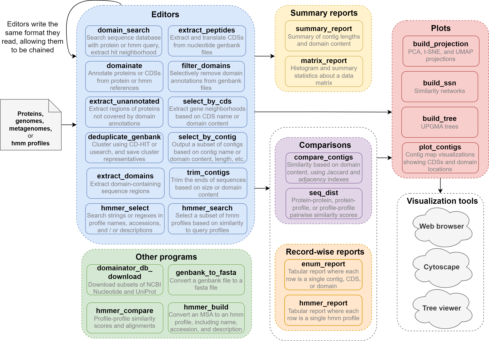
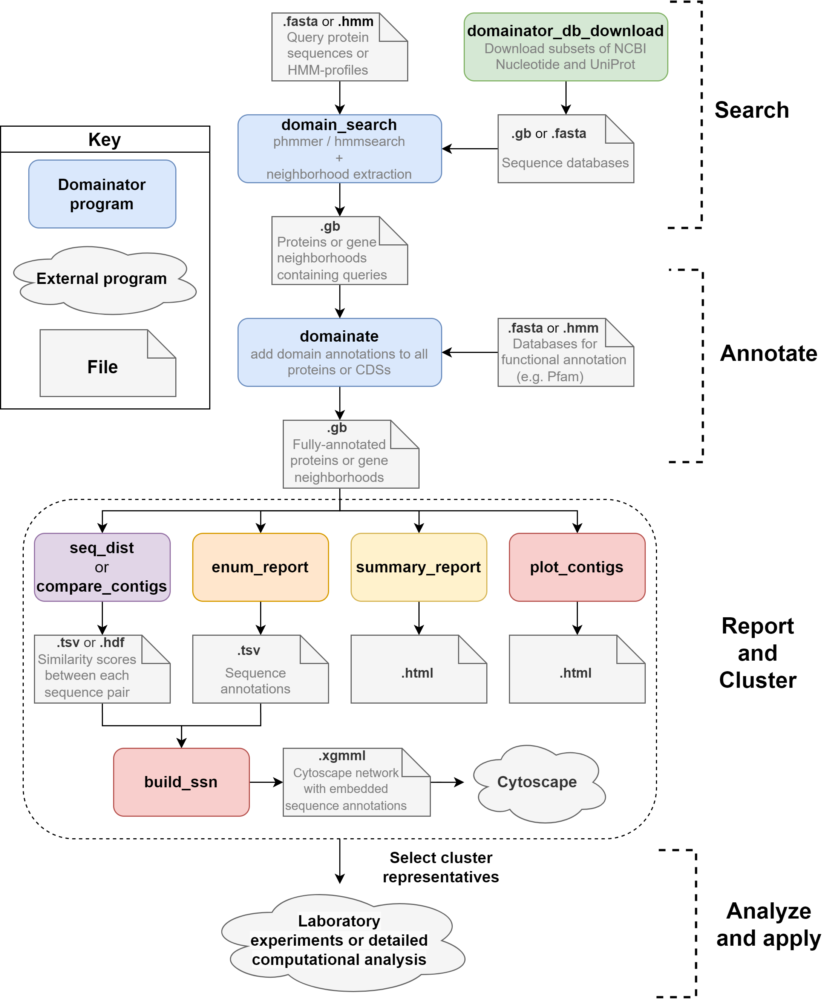
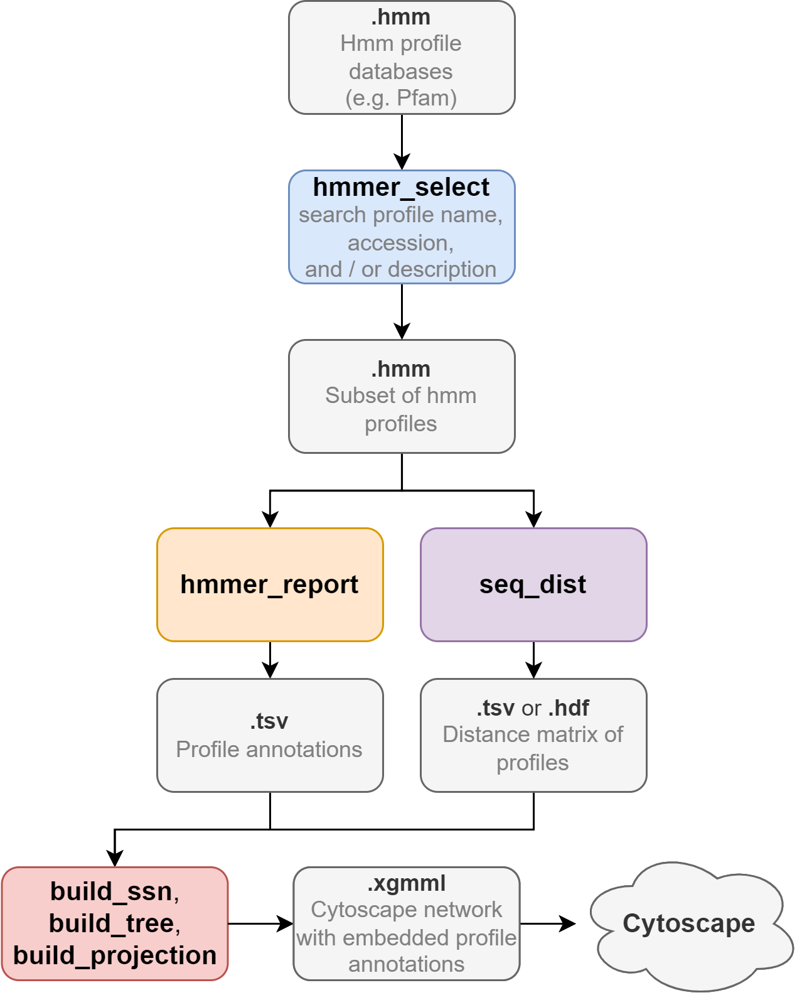

# Domainator

A flexible and modular software suite for domain-based gene neighborhood and protein search, extraction, and clustering.

Domainator can be run as command line tools or as a Python library.

# Quickstart

```
conda create -n domainator -c conda-forge -c bioconda domainator python=3.12
conda activate domainator
domainator --help
```
`domainator --help` lists the commands, and `domainator <command> --help` describes one; `domainator doctor` lists the optional programs and which ones you have. This installs the released version from bioconda. See [Installation](#installation) to install from this repository instead, with every optional program.

# Contents
 - [Overview and key concepts](#Overview-and-key-concepts)
 - [Program descriptions](#Program-descriptions)
 - [Requirements](#Requirements)
 - [Installation](#Installation)
   - [Conda](#Conda)
   - [Apptainer (Singularity)](#Apptainer-(Singularity))
 - [Updating](#Updating)
 - [Examples](#Examples)
 - [Driving Domainator from other programs](#driving-domainator-from-other-programs)
 - [Using Domainator as a python library](#Using-Domainator-as-a-python-library)
 - [Credits](#Credits)

## Detailed documentation
- [The documentation website](https://nebiolabs.github.io/domainator/): these pages and the Python API reference
- [Index](docs/README.md)
  - [File Formats](docs/file_formats.md)
  - [Basic Examples](docs/examples.md)
    - [As a Google Colab notebook](https://colab.research.google.com/github/nebiolabs/domainator_examples/blob/main/colab_notebooks/Domainator.ipynb)
  - [Agent-driven workflows](docs/agent_workflows.md) (see also [AGENTS.md](AGENTS.md))
  - [Advanced examples](https://github.com/nebiolabs/domainator_examples)
  - [Developing Domainator](docs/developing_domainator.md)
  - [Structure search and annotation](docs/structure_search.md)
  - [ESM-2 3B 3Di and foldseek integration](docs/esm_3b_foldseek.md)
  - [Limitations and frequently asked questions](docs/limitations_and_FAQ.md)
  - [Command-line reference](docs/cli/README.md)
  - [The tool manifest, for programs that drive Domainator](docs/tool_manifest.md)

# Questions, comments, bug reports, and feature requests
Please use our [discussions page](https://github.com/nebiolabs/domainator/discussions) or [create an issue](https://github.com/nebiolabs/domainator/issues)

# Overview and key concepts

Domainator provides several dozen discrete, flexible programs that can be composed into a broad range of workflows via command line or python scripting. Domainator also treats HMM-profiles as first-class citizens, supporting subsetting of .hmm files and comparison of HMM-profiles, including the construction of profile similarity networks and trees.

Domainator uses the GenBank file format as a carrier of both sequence and annotation data. Independence from a fixed set of sequence sources and the co-location of sequences and all their annotation data in a single file increases data portability and decreases complexity for end-users. Domainator can add functional annotations to sequences by comparison to protein HMM-profiles, protein sequences, nucleotide sequences, nucleotide HMMs, or infernal covariance models. Protein references are searched against CDSs or protein records, while nucleic-acid references are searched against whole nucleotide contigs. For example, in a single call to domainate, a set of genome or metagenome contigs can be annotated with hits to Pfam HMM-profiles, RFAM profiles, and hits to REBASE Gold Standard protein sequences at the same time.

The individual programs that make up Domainator can be roughly classified into six categories corresponding to their typical roles in workflows. The first steps in most workflows typically involve passing sequence data through one or more editors.

__Editors__ are programs whose output format is the same as their input format. Each individual editor performs a simple task, but they can be combined in arbitrarily long chains to accomplish complex transformations. Examples are domain_search, which outputs a subset of the input sequences, based on the presence of a hit to a reference sequence or profile; domainate, which outputs all the input sequence but adds domain annotations based on hits to reference sequences; deduplicate_genbank, which performs similarity clustering using CD-HIT, usearch, or DIAMOND and outputs only the cluster representatives input sequences; and select_by_cds, which extracts genome neighborhoods around domains of interest. 

__In Domainator programs, perhaps differently from other software, the file being edited is supplied via the `-i` argument and criteria for editing is supplied via other arguments, such as the `-r` argument for reference sequences or hmm profiles. For example searching for hits to a query in the UniProt database may be accomplished via `domainator domain_search -i uniprot.fasta -r query.hmm -o hits.gb`, similarly annotating a set of contigs with Pfam annotations may be accomplished with `domainator domainate -i unannotated.gb -r pfam-A.hmm -o annotated.gb` .__

__Summary report programs__ summarize data into graphs and statistics, for example, the number of sequences in a file and the count of each kind of domain. Record-wise report programs produce tab-separated files, for example where each row corresponds to a genome contig, a protein, or a domain, and values are data such as length, taxonomy ID, domain content, etc. 

__Record-wise reports__ are useful for exporting data to programs, such as Excel, which can’t read GenBank or hmm files, and they also find use as intermediary files between some programs in Domainator.

__Comparison programs__  generate pairwise score or distance matrices between contigs or HMM-profiles. Compare_contigs uses the Jaccard  and adjacency  indexes to compare proteins or gene neighborhoods based on their domain content, whereas seq_dist uses local alignment scores, for example via phmmer , Diamond , hmmsearch , or the Viterbi profile-comparison algorithm. Structure_dist compares protein structures directly by structural alignment, scoring them by alignment score, TM-score, lDDT or sequence identity. Comparison programs output data matrices.

__Plotting programs__ convert data into formats appropriate for graphical visualization, for example converting score matrices and tabular metadata into trees or similarity networks which can be viewed in Cytoscape  or other external visualization tools, depending on the data type.

Finally, there are few programs that defy categorization, these programs perform functions such as downloading data from NCBI or UniProt, converting files between formats, or generating profile-profile alignments.

## Overview of Domainator components

*not all programs are shown

## Example genome mining workflow



## Example HMMER profile comparison workflow




# Program descriptions

Every program is a command of the `domainator` program: `domainator <command> [options]`, for example `domainator domainate -i contigs.gb -r pfam.hmm -o annotated.gb`. Run `domainator --help` for the list of commands, and `domainator <command> --help` for the documentation of each one. Every command also takes `-v/--verbose` (debug output, and a traceback for errors) and `-q/--quiet` (errors only, no progress messages or warnings).

To complete command names and options with the Tab key, install the shell completion script once (and again after upgrading Domainator):

```bash
# bash
domainator completion bash > ~/.local/share/bash-completion/completions/domainator
# zsh: write it to a directory on your $fpath, named _domainator
domainator completion zsh > ~/.zfunc/_domainator
```

Programs that can accept streaming input read genbank formatted data from `stdin` with `-i -`. Programs that need to pass over the input multiple times can't support streaming input.
Programs that can produce streaming output write to `stdout` when an output is given as `-`, for example `-o -` or `--fasta_out -`. Nothing is read from `stdin` or written to `stdout` unless asked for.
You can use shell pipes to move data from a program that supports streaming output into a program that supports streaming input, for example `domainator domainate -i in.gb -r pfam.hmm -o - | domainator select_by_cds -i - --domains CcdB -o out.gb` (but note that it is more efficient to use domainator as a python library, see below).
Many commands that can generate large outputs also support `--max_output_gb` to fail early when a projected output would exceed the configured size limit. The default limit is 25 GB, and setting `--max_output_gb 0` disables the guardrail.

| Program | Description | input |  output  | streaming input  |  streaming output  |  notes  |
| ---- | ----- | ---- |---| -- | -- | ------------- |
|  domainator build_projection | generates 2d or 3d umap, tsne, or pca projections | a data matrix (hdf5 or tab-separated text), could be a sequence similarity matrix, or any other kind of data matrix. optionally, a table of node metadata. |  typically a Cyoscape xgmml file or a png image file. Other outputs are possible.  |  no  |  no  | |
|  domainator build_ssn |  generates a Cytoscape file with a sequence similarity network (SSN)  |  a sparse matrix of network edges. optionally, a table of node metadata  |  typically a Cyoscape xgmml file, other SSN related files are possible | no  | no  | |
|  domainator build_tree | Converts a distance matrix into a UPGMA tree |  a distance matrix, or a similarity matrix to convert into distances  | Newick or Cytoscape file  | no  | yes | Can attach annotations to cytoscape files, based on supplied metadata. |
|  domainator clean_sequences | cleans sequence names and residues, and drops sequences with non-canonical residues | genbank or fasta files | a genbank or fasta file, and optionally a log of the changes | yes | yes | |
|  domainator color_genbank  |  creates color qualifiers on CDS and/or domainator features based on domainator annotations |  domainator-annotated genbank files. optionally a tab-separated map of domain names to hex colors.  | a genbank file | yes | yes | To auto color most domains but give explicit colors to some, run twice. First without a tsv map, then with a tsv map. |
| domainator color_table_to_legend | Generates an SVG legend based on a color table | tab separated file of annotation names and color codes | an svg file | yes | yes |  |
|  domainator compare_contigs |  calculates similarities between contig, based on metrics such as domain adjacency index and domain jaccard index.  | domainator-annotated genbank files | Genbank file where contigs are sorted according to hierarchical clustering of similarity. sparse or dense similarity matrices.  | yes | yes | If you want to pipe genbank output you can explicitly supply `-o -`. Other kinds of output planned for the future, such as phylogenetic trees of contigs. |
|  domainator deduplicate_genbank |  runs a clustering algorithm, such as cdhit, usearch, or diamond on sequences from a genbank file to reduce redundancy.  | genbank nucleotide or peptide files  |  a genbank file  |  no  | yes |  |
|  domainator domain_search | Search a small number of protein or nucleic-acid references against a database | genbank (protein genbank, or nucleotide genbank with CDS annotations) or protein/nucleotide fasta files to search through. Protein HMMs and FASTA search CDSs or protein records; nucleotide FASTA, nucleotide HMMs, and infernal CMs search whole nucleotide contigs. |  a genbank file  |  no  | yes | Protein inputs cannot be searched with nucleotide references. `--partial exclude` skips fragments (partial CDSs and UniProt `(Fragment)` records), see [partial features](docs/file_formats.md#partial-features-and-fragments). |
|  domainator domainate  | annotates contig or protein sequences with protein or nucleic-acid hits | genbank (protein genbank, or nucleotide genbank with CDS annotations) or protein/nucleotide fasta files to annotate. Supported references include protein HMMs, protein FASTA, nucleotide FASTA, nucleotide HMMs, and infernal CMs. | a genbank file with new annotations | no | yes | Nucleotide references search whole contigs rather than individual CDSs. Consider `domainator domain_search` if searching for small numbers of references against large databases. `--partial exclude` skips fragments, see [partial features](docs/file_formats.md#partial-features-and-fragments). |
|  domainator db_download | Download databases from the internet in formats appropriate for domainator  |  None | genbank or fasta  | N/A  | yes | For NCBI genome databases, the default `--download_backend datasets` uses the NCBI Datasets CLI (`ncbi-datasets-cli`, installed with the conda env) for NCBI-friendly bulk downloads. Use `--download_backend direct` for HTTPS downloads without that dependency; keep `--download_workers` low (~3) to avoid NCBI rate-limiting. |
|  domainator enum_report | from a genbank file generates a tab separated file of properties and metadata related to the input, for example the domain content of each contig or cds. | genbank files | a tab separated, html, or JSON (`--json_out`, streaming NDJSON) metadata table  | yes | yes |  |
|  domainator extract_domains | Takes a domainator-genbank file, looks for the specified domains, and extracts them from the contigs.  |  a (nucleotide or peptide) genbank file.  |  a genbank or fasta file of the same sequence-type (nucleotide or peptide) as the input  | yes  |  yes  | If you want to extract peptide domains from a nucleotide genbank, pass the output of this program into extract_peptides (or vice-versa) |
|  domainator extract_peptides | extracts translated peptide sequences from nucleotide genbank sequences, preserves the domainator annotations (other annotations are lost) |  nucleotide genbank file  |  peptide genbank file  | yes  | yes | |
|  domainator extract_unannotated | Takes a domainator-genbank file, extracts regions not covered by any domain annotations  |  a peptide genbank file.  |  a peptide genbank or fasta file  | yes  |  yes  |   |
|  domainator filter_domains  |  applies more stringent filtering to domainator-annotated genbank files.  |  domainator-annotated genbank files  |  a genbank file  |  yes  | yes  | If you want to annotate the same genbank file with multiple evalue or max_overlap cutoffs, it is often faster to run domainator.py first with loose cutoffs, then run domainator filter_domains with more stringent cutoffs. To clear all annotations, just run `domainator filter_domains` with an evalue of `-1`|
|  domainator find_features | annotates transmembrane regions and signal peptides (TMbed) and PROSITE motifs as Domainator features | protein or nucleotide genbank or fasta files | a genbank file | yes | yes | `--tmbed` needs the `structure` extra and TMbed (see [Requirements](#requirements)). |
|  domainator genbank_to_fasta | converts genbank files to fasta files  | one or more genbank files  | a fasta file | yes  | yes  |  |
|  domainator hmmer_build | runs hmmbuild. Unlike the hmmbuild from the HMMER3 package, domainator hmmer_build allows specifying accession and description from the command line | an MSA | a .hmm file (optionally gzipped) | yes | yes | Builds amino acid, DNA, and RNA profiles. The alphabet is inferred from the alignment, or set explicitly with `--alphabet`. `--window_length` and `--window_beta` set the nhmmer search window (the profile's MAXL field) for nucleotide profiles. |
|  domainator hmmer_compare |  runs local profile alignment, calculating pairwise hmm scores and position-wise alignments |  hmmer3 profiles  |  scores and (optionally) alignments |  yes | yes | hmmer_compare, hmmer_search, and seq_dist can all be used to compare profiles, with different outputs. Amino acid, DNA, and RNA profiles are all supported, but both sides must use the same alphabet. Scores are on the input alphabet's own scale: nucleotide scores run at roughly half the amino acid scale. |
|  domainator hmmer_report |  Writes a tabular report from .hmm files, with a line for each profile | one or more .hmm files | a tab separated, html, or JSON (`--json_out`, streaming NDJSON) metadata table | yes  | yes  | `--columns alphabet` reports whether each profile is amino, DNA, or RNA. |
|  domainator hmmer_search |  Selects hmm profiles based on similarity scores to a reference set of hmm profiles |  hmmer3 profiles (optionally gzipped)  |  hmmer3 profiles (optionally gzipped) |  yes |  yes  | hmmer_compare, hmmer_search, and seq_dist can all be used to compare profiles, with different outputs. Amino acid, DNA, and RNA profiles are all supported, but `-i` and `-r` must use the same alphabet. The default `--min_score` is scaled to the alphabet, because nucleotide scores run at roughly half the amino acid scale. |
|  domainator hmmer_select | Extracts a subset of profiles from .hmm files  | one or more .hmm files (optionally gzipped) | an hmm file (optionally gzipped) | yes  | yes  | All `--input` files must use one alphabet, because HMMER locks an .hmm file to the alphabet of its first profile. `--alphabet` splits a mixed set of files into per-alphabet outputs. |
|  domainator infernal_build | runs Infernal's cmbuild to build a covariance model from an RNA alignment (experimental) | a Stockholm alignment | a .cm file | yes | yes | Needs Infernal (`cmbuild`). |
|  domainator kmer_dist | calculates exact k-mer similarity scores between sequence records | two sequence files (genbank or fasta). Protein inputs use protein k-mers; nucleotide inputs use translated CDS protein k-mers by default or strand-invariant nucleotide k-mers with `--nucleotide_kmers`. Use `--alphabet` to disambiguate FASTA inputs and `--gene_call` to create CDS annotations for nucleotide FASTA. | a sparse or dense matrix of similarity scores | no | yes | Supports `max_containment`, `min_containment`, and `jaccard` metrics. |
|  domainator matrix_report | generates a histogram and summary statistics from a data matrix | a similarity matrix (hdf5 or tab-separated text) | a report with graphics and statistics (html), a text report, or a compact JSON summary (`--json_out`) | no | yes |  |
|  domainator build_ssn_viewer | builds a `.dsnv` bundle and/or a standalone, dependency-free HTML Domainator Similarity Network Viewer for exploring a sequence similarity network in a browser | a symmetric similarity matrix. optionally, tables of node metadata | a `.dsnv` bundle (gzip JSON) and/or a self-contained HTML file (`--html_out`, with `--embed_data` to inline the bundle) | no | no | The viewer reconstructs clusters at any threshold from an MST hierarchy, so the bundle scales with node count rather than edge count. Metadata can be edited and annotated in the browser, and "Save session" writes a bundle carrying those edits plus the viewer state. Each metadata column header carries a chart glyph that builds a frequency table, bar or pie chart, histogram, box plot, cumulative distribution or summary statistics over the rows the table is showing, inheriting the column's colors and exportable as SVG, PNG or TSV. See [docs/ssn_viewer.md](docs/ssn_viewer.md) for a guide to the viewer itself. |
|  domainator ssn_navigator | read-only navigation of a build_ssn_viewer `.dsnv` bundle: lists clusters, cluster contents, and per-cluster metadata distributions at a chosen similarity threshold | a `.dsnv` Domainator Similarity Network Viewer bundle | compact JSON (overview / thresholds / clusters / cluster / node queries) | no | yes | Agent-friendly companion to the interactive HTML Domainator Similarity Network Viewer. |
|  domainator format_db | Prepares a `domain_search` database: split into shards (`--shards N`), BGZF-compress (`--compress`), and/or write `.didx` offset indexes. | genbank or fasta file(s), optionally gzip/BGZF | optional shard files (`<base>.N.<ext>`), optional `.bgz` compression, and optional `.didx` index sidecars | no | no | Operations are opt-in (`--shards`/`--compress`/`--index`). Indexes let `domain_search` skip the per-run offset scan; a logical db name auto-resolves to its shards. |
|  domainator plot_contigs | Creates graphical representations of contigs with their annotations. | a genbank or fasta file  | an html file | yes | yes | |
|  domainator rotate_contigs | Sets the origin of circular contigs at the start, end, or center of a new (`-r`) or pre-existing domain annotation, reverse complementing so the domain is on the forward strand. | nucleotide genbank or fasta files  |  a genbank or fasta file  |  yes |  yes  | Linear contigs and fasta records are skipped unless `--circularize` is set. |
|  domainator select_by_cds |  Extract contigs or contig regions based on CDS names or domain content within individual CDSs | domainator-annotated nucleotide genbank files  |  a genbank file  |  yes |  yes  | Supports boolean logic for domain selector statements. If `--pad` option is set, then output streaming is not in real-time and memory usage will be higher, because all records need to be read before padding sizes can be calculated. `--anchor` aligns on the start, end, or center of the focus CDSs.  |
|  domainator select_by_contig | Extract a subset of contigs based on domain content of the entire contig | domainator-annotated genbank files  |  a genbank file | yes |  yes  | Supports boolean logic for domain selector statements. |
|  domainator select_by_coord | extracts the contig regions listed in a coordinate table | genbank or fasta files, and a table of contig, start, end and optionally strand | a genbank file | yes | yes | Coordinates are 1-based and inclusive. |
|  domainator seq_dist | calculates similarity scores between protein sequences |  two peptide sequence files (genbank or fasta), a sequence file and an hmm file, or two hmm files.  |  a matrix of similarity scores (hdf5 or tab-separated text)  | no  | yes |  Typically the input and reference will be the same sequence file, creating a pairwise similarity matrix. It can also use an hmm file as a reference to make a table of profile scores for each input peptide. |
|  domainator sort_contigs | sorts contigs by their best Domain_Search score, or by the scores of named Domainator domains | domainator-annotated genbank files, typically domain_search output | a genbank file | yes | yes | Gives the order `domain_search --max_hits` uses, for output written without it. |
|  domainator split_by_cluster | splits a sequence or profile file into one file per cluster of a similarity matrix | a sequence or hmm file, and a similarity matrix | a directory with one file per cluster | no | no | |
|  domainator structure_dist | calculates similarity or distance matrices between protein structures |  structure files (pdb/cif, optionally gzipped; files, a glob, or a directory searched recursively) or a prebuilt aligner database, optionally a second set as the reference  |  a matrix of similarity or distance values (hdf5 or tab-separated text)  |  no  | yes | The structure-input counterpart of `domainator seq_dist`. Rows are inputs and columns are references, the opposite of the other structure tools, so `--evalue` is computed against the reference set as it is in `domainator seq_dist`. Row and column labels are the same record ids `domainator structure_to_genbank` writes, so the matrix feeds `domainator build_ssn`, `domainator build_tree` and `domainator build_ssn_viewer` directly. `--mode` adds `tmscore`, `lddt` and `fident` (and their `_dist` forms) to seq_dist's score-based modes; `tmscore` and `lddt` need `--algorithm foldseek`. |
|  domainator structure_domainate | annotates protein structures with hits to reference structures | structure files (pdb/cif, optionally gzipped; files, a glob, or a directory searched recursively) or a prebuilt aligner database, plus reference structures or an aligner database | a protein genbank file, one record per structure chain, with `Domainator` annotations | no | yes | The structure-input counterpart of `domainator domainate`. Every input chain is written, whether or not it had hits. Because the databases are built from real structures they carry C-alpha coordinates, so `--alignment_type 1` (TM-align) and the `--metrics` tmscore/lddt/rmsd are available with the default foldseek backend. `--algorithm reseek` selects reseek instead. Consider `domainator structure_search` when searching a large database with a few references. |
|  domainator structure_search | searches a structure database with a small number of reference structures | a prebuilt aligner database (for example a foldseek database built from AlphaFold DB), or structure files to build one from, plus reference structures | a protein genbank file of the hit records, each with a `Domain_Search` annotation | no | yes | The structure-input counterpart of `domainator domain_search`. With the default foldseek backend, hit records are built from the sequences the aligner reports, so the searched database is never read end to end. `--algorithm reseek` selects reseek instead. `--max_seqs` bounds how many hits the aligner keeps per reference; raise it for large databases, and note the warning when a reference saturates it. |
|  domainator structure_to_genbank | converts protein structures into a protein genbank file | structure files (pdb/cif, optionally gzipped) or a prebuilt aligner database | a protein genbank file, one record per structure chain | no | yes | Makes structures ordinary Domainator inputs, so the sequence-based tools work on them unchanged. `--db_out` also persists the aligner database, which carries C-alpha coordinates and can be reused as the input or reference of the other two structure tools. `--algorithm` selects foldseek (default) or reseek. |
|  domainator summary_report |  Calculates statistics such as number of contigs, average contig length, and frequency of each domain   |  a domainator-annotated genbank file  |  an html file of the report (with figures/statistics), a text report, and/or a compact JSON summary (`--json_out`) |  yes  | yes |  'focus domains' can be specified, which will make the output include information about the co-occurrence and distance of those domains with other domains. Can also write a report to the console. |
|  domainator transform_matrix | Converts matrices in score format to matrices in various normalized score formats  |  a data matrix of scores  | a data matrix of normalized scores or distances  |  no  | yes |  |
|  domainator trim_contigs | trim the ends of contigs | nucleotide or protein genbank or fasta files |  a genbank file  |  yes |  yes  | Supports boolean logic for domain selector statements. |
|   |   |   |   |   |   |  |


# Requirements

Domainator is developed on Linux, and has been tested on Mac. It probably won't work on Windows, except through WSL. It needs Python 3.12 or newer.

A few commands also need an external program or an optional Python package. The conda environment below installs all of them except esmologs and TMbed; `domainator doctor` lists which ones your installation has.

| Program or package | Needed by | Install |
|---|---|---|
| diamond | `seq_dist` (default algorithm), `deduplicate_genbank --algorithm diamond` | `conda install -c bioconda diamond` |
| cd-hit | `deduplicate_genbank` (default algorithm) | `conda install -c bioconda cd-hit` |
| usearch | `deduplicate_genbank --algorithm usearch` | `conda install -c bioconda usearch` |
| foldseek | `domainate --foldseek`, the `structure_*` commands (default aligner) | `conda install -c conda-forge -c bioconda foldseek` |
| reseek | `structure_* --aligner reseek` | build from https://github.com/rcedgar/reseek |
| cmbuild (Infernal) | `infernal_build` | `conda install -c bioconda infernal` |
| datasets | `db_download` of NCBI genomes | `conda install -c conda-forge ncbi-datasets-cli` |
| umap-learn | `build_projection --algorithm umap` | `pip install "domainator[projection]"` |
| matplotlib, seaborn | `build_projection --png_out` | `pip install "domainator[projection]"` |
| torch, esmologs | `domainate --foldseek` on sequences (ESM-2 to 3Di) | `pip install "domainator[structure]"`; esmologs: see [docs/esm_3b_foldseek.md](docs/esm_3b_foldseek.md) |
| TMbed (and torch) | `find_features --tmbed` | see [TMbed](#optional-tmbed-for-find_features---tmbed) |

Domainator ships an optional native (Rust) extension that greatly speeds up GenBank/FASTA parsing and offset scanning. Building it requires a **Rust toolchain (≥ 1.83)** — which the conda environment installs for you — and a **C compiler/linker** (`gcc`/`clang`). If either is unavailable the extension is skipped and Domainator falls back to a slower pure-Python parser; results are identical either way. See [Native (Rust) acceleration](#native-rust-acceleration) below.

# Installation

There are two ways to install Domainator:

- **The released version, from bioconda:** `conda create -n domainator -c conda-forge -c bioconda domainator`, as in the [Quickstart](#quickstart). Install any optional programs you need into the same environment (see [Requirements](#requirements)).
- **From this repository**, with the conda environment below, which also installs the optional programs except esmologs and [TMbed](#optional-tmbed-for-find_features---tmbed). Use this for the newest code or to develop Domainator.

__NOTE:__ For Installation with ESM-2 3B 3Di and foldseek integration, see [here](docs/esm_3b_foldseek.md)

## Conda

### Step 0: Install miniconda
If you don't already have a conda distribution installed, install one, such as miniconda.

[Miniconda](https://docs.conda.io/en/latest/miniconda.html)

or

[Mambaforge](https://github.com/conda-forge/miniforge#mambaforge)

### Step 1: Download and install the domainator package

Clone the [Domainator github repository](https://github.com/nebiolabs/domainator) and enter it:

```bash
git clone https://github.com/nebiolabs/domainator.git
cd domainator
```

Then create the conda environment, which installs Domainator and the external programs it uses:

On Linux:
```bash
conda env create -f conda_env.yml #x86_64 systems such as most linux machines, and older Apple machines.
```

On Mac:
```bash
conda env create -f conda_env_arm64.yml # ARM systems such as recent Apple machines, and a few linux machines.
```


This will create a new conda environment called "domainator".

### Step 2: Activate the environment before you install packages or run any script
```bash
conda activate domainator
```

### Optional: TMbed, for `find_features --tmbed`

`find_features --tmbed` predicts transmembrane regions and signal peptides with
[TMbed](https://github.com/BernhoferM/TMbed). The conda environment does not install it: TMbed is
not on PyPI, and it brings in PyTorch, which is several GB. To use it, install it into the
activated environment (or wherever you installed Domainator with pip):

```bash
conda activate domainator
pip install "transformers<5" "tmbed @ git+https://github.com/BernhoferM/TMbed.git@8cee893523eb655bc9485c00c65336d27a236191"
domainator doctor   # should now list torch and tmbed as found
```

- **Python 3.14 or older.** PyTorch has no Python 3.15 builds yet, so on 3.15 pip reports
  `No matching distribution found for torch`. Check with `python --version`; to make the
  environment on 3.14 instead, run `conda create -n domainator python=3.14` and then
  `conda env update -n domainator -f conda_env.yml` in place of Step 1's `conda env create`.
- **`transformers<5`**: TMbed uses tokenizer methods that transformers 5 removed.
- **The TMbed commit is pinned** because TMbed has no releases; this is the version Domainator is
  tested with.
- **GPU or CPU.** `--device` (default `cuda:0`) falls back to the CPU when CUDA is not available.
  pip's default PyTorch on Linux includes CUDA libraries. For a smaller CPU-only install, install
  PyTorch first with `pip install torch --index-url https://download.pytorch.org/whl/cpu`.
- **Model download.** The first run downloads TMbed's ProtT5 encoder (about 2.25 GB), by default
  into the installed `tmbed` package. Use `--tmbed_model_dir` (or `--model_dir`, or the `HF_HOME`
  environment variable) to keep it somewhere else, such as a shared directory.

### Native (Rust) acceleration

Domainator includes an optional native extension (`domainator._gbfast`) that makes
GenBank/FASTA parsing and offset scanning several times faster. It is **optional**:
Domainator runs correctly without it, just more slowly (it falls back to a pure-Python
parser), so this step can be skipped if you can't build it.

The conda environment already installs the Rust toolchain. You also need a C
compiler/linker on your `PATH`:

- **Linux:** `gcc` — e.g. `sudo apt install build-essential`, or, inside the conda env,
  `conda install -c conda-forge c-compiler`
- **macOS:** the Xcode command line tools — `xcode-select --install`

With the environment activated, build the extension and confirm it loaded:

```bash
conda activate domainator
pip install --no-deps --force-reinstall .
python -c "from domainator import _gbfast; print('native (Rust) acceleration: ENABLED')"
```

If the import raises `ModuleNotFoundError`, the extension was not built — check that
`cargo`/`rustc` and a C compiler are on your `PATH` — and Domainator will transparently
use the slower Python parser instead.

> Developing Domainator? Use an editable build instead so source edits take effect
> without reinstalling. The editable + build-isolation path does **not** compile the
> extension, so disable isolation and provide the build backend explicitly:
> ```bash
> pip install "setuptools-rust>=1.7"
> pip install -e . --no-build-isolation
> ```

## Apptainer (Singularity)

Navigate to the directory containing this README file. It should also contain a file called `domainator.def`. In that directory execute the command:

```bash
apptainer build domainator.sif domainator.def
```

Or (if you have singularity not apptainer)

```bash
singularity build domainator.sif domainator.def
```

Then to execute domainator commands, prefix any command with 
```bash
apptainer exec domainator.sif [command here]
# for example:
apptainer exec domainator.sif domainator domainate -i test/data/pDONR201_multi_genemark.gb -r test/data/pdonr_hmms.hmm -o example_out.gb
```

# Updating

In the repository folder, get the new version and recreate the environment:

```bash
git pull
conda env create --yes -f conda_env.yml
```

This will delete the old `domainator` conda environment and replace it with the updated version.

If you use the [native (Rust) acceleration](#native-rust-acceleration), rebuild it after updating (`pip install --no-deps --force-reinstall .` with the environment activated).

# Examples

## Run Domainator to annotate contigs with Pfam

Activate the domainator conda environment
```bash
conda activate domainator
```

To run domainator on a single file
```bash
# download and extract Pfam
wget https://ftp.ebi.ac.uk/pub/databases/Pfam/current_release/Pfam-A.hmm.gz
gunzip Pfam-A.hmm.gz

# run Domainator
domainator domainate --cpu 4 --max_overlap 0.6 -i your_genbank.gb -r Pfam-A.hmm -o domainator_output.gb
```

## Visualizing output
```bash
domainator summary_report -i domainator_output.gb --html_out domain_summary.html
domainator enum_report -i domainator_output.gb --by contig --columns taxname:superkingdom:genus:species:self length domains --html_out enum_report.html -o enum_report.tsv
domainator plot_contigs -i domainator_output.gb --html_out contigs_plot.html
```

For more examples see: [Basic Examples](docs/examples.md), and [Advanced examples](https://github.com/nebiolabs/domainator_examples).

# Driving Domainator from other programs

`domainator describe` prints a JSON description of every command and its options, which a GUI
or a workflow system can render as forms and run with `domainator <command> --config
options.json`. The browser GUI that used to be bundled (`domainator_server`) is becoming a separate
project built on it. See [docs/tool_manifest.md](docs/tool_manifest.md).

# Using Domainator as a python library

## Basics
Most executables in Domainator are based on a core function that acts as a editors on BioPython SeqRecord objects. So you can chain them within python scripts, keeping sequences as SeqRecords instead of writing and reading Genbank files.
Chaining the functions will be similar to piping the output of one program to another, but will be faster because superfluous conversions from Genbank to SeqRecord and back again will be avoided. A caveat is that you lose some input and output validation (See also [Interoperability with BioPython](#Interoperability-with-BioPython)). 

The general way to access these functions is `from domainator.[script_name] import [script_name]`. See the [API reference](docs/api/index.md) for each function's parameters.

## Interoperability with BioPython

Domainator's records are ordinary Biopython `SeqRecord` objects. For reading and writing Domainator-compatible sequence files, use `domainator.parse_seqfiles` and `domainator.write_genbank`: they keep qualifier values intact (Biopython's own GenBank writer wraps long values, which inserts spaces into them) and add Domainator's per-CDS annotation qualifiers.

# Credits

## Please cite
Johnson, Sean R., Peter Weigele, Alexey Fomenkov, Andrew Ge, Anna Vincze, James B. Eaglesham, Richard J. Roberts, and Zhiyi Sun. “Domainator, a Flexible Software Suite for Domain-Based Annotation and Neighborhood Analysis, Identifies Proteins Involved in Antiviral Systems.” 2024, _Nucleic Acids Research_, gkae1175. [https://doi.org/10.1093/nar/gkae1175](https://doi.org/10.1093/nar/gkae1175).


## Projects that domainator draws inspiration from
  - [BigScape/Corason](https://bigscape-corason.secondarymetabolites.org/)
  - [EFI](https://efi.igb.illinois.edu/)
  - [pydna](https://github.com/BjornFJohansson/pydna)
  - [antiSMASH](https://github.com/antismash/antismash)
  - [HMMER3](https://github.com/EddyRivasLab/hmmer)
    - [pyHMMER](https://github.com/althonos/pyhmmer)

## Contributors
 - Sean Johnson 
 - Peter Weigele
 - Zhiyi Sun 
 - Andrew Ge
 - Yu-Cheng Lin

