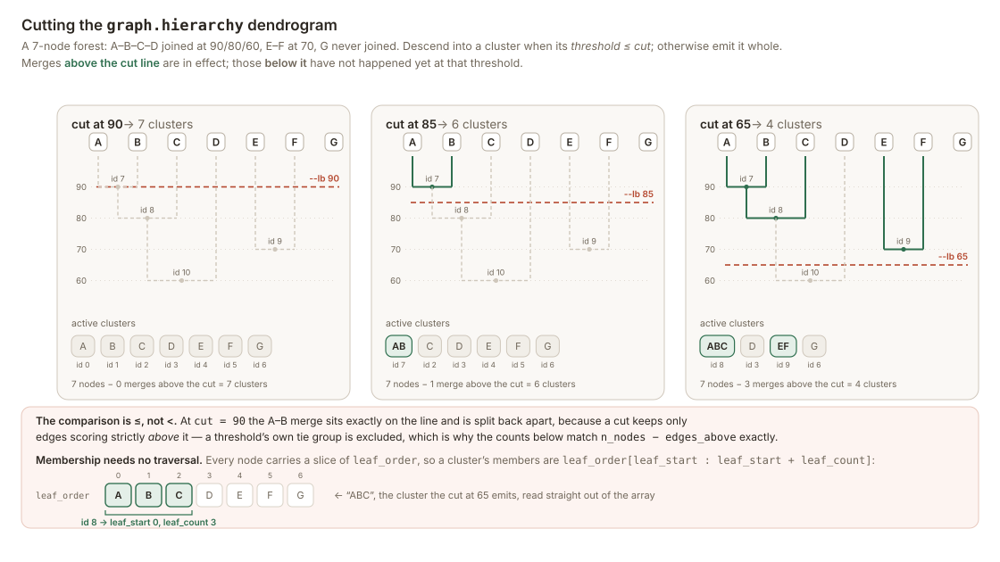

[index](README.md)
# Domainator file formats

## Sequence identity

Within datasets used together, Domainator assumes that **records with the same ID
have the same sequence**. Different IDs may refer to identical sequences, and
annotations and focus-hit scores may differ even when the ID and sequence agree.
If records reuse an ID for different sequences, rename them before combining or
searching them. Tools that deliberately preserve names while changing sequences
leave that responsibility to the caller.

Deduplication compares output records before padding and relies on this invariant;
it does not maintain a global ID-to-sequence validation table. Thus
`--dedup sequence` and `--dedup sequence_rc` also guarantee unique IDs.
Deduplication therefore needs only one policy, not a combination of selectors.

## Genbank

Genbank files are the sequence format most used by Domainator. Genbank files are convenient because they can store information on both sequence and sequence positional annotations.

### Features
Domainator produces and understands some feature types particular to it.

`Domainator` features are domain annotations added to genbank files by `domainator domainate` or `domainator domain_search`. The `cds_id` qualifier is particularly critical as it links the `Domainator` feature to a `CDS` feature. Domainator adds a `cds_id` qualifier to any `CDS` feature lacking one. The `cds_id` is expected to be unique within a contig. The general format for an automatically generated `cds_id` is `[start coordinate]_[strand]_[end coordinate]`. Multi-part CDSs, for example CDSs containing introns or crossing the origin are handled in a somewhat more complicated way, as special cases, with the goal being to maintain a one-cds_id to one_cds relation. For nucleotide contig-level annotations (produced by nhmmer or infernal searches), `cds_id` is set to `"."` because the hit is not associated with a particular CDS.

`rstart`, `rend` are the start and end coordinates of the local alignment in the "reference" (i.e. profile). `rlen` is the total length of the reference profile, so you can get an idea of how the local alignment is oriented with respect to the entire reference profile/sequence.

```javascript
     Domainator      560..1165
                     /program="hmmsearch"
                     /database="pdonr_hmms"
                     /description="Chloramphenicol acetyltransferase"
                     /evalue="4.0e-100"
                     /score="329.7"
                     /name="CAT"
                     /identity="55.9"
                     /cds_id="2265_-1_1606"
                     /rstart="1"
                     /rend="100"
                     /rlen="100"
```


Annotations produced by a structural aligner (`domainator structure_domainate`, `domainator structure_search`) carry the same qualifiers, with `program` naming the aligner (for example `foldseek`). They may additionally carry `tmscore`, `lddt`, `rmsd` and `prob` when those were requested with `--metrics`. These four qualifiers are optional and are simply absent when the aligner did not compute them, so files written by the sequence-based tools are unchanged. They are scores for the alignment as a whole, on their own scales rather than on the `score` bitscore scale, so they should not be compared against `score` or against each other.

```javascript
     Domainator      1..76
                     /program="foldseek"
                     /database="refs"
                     /description="."
                     /evalue="3.1e-18"
                     /score="635.0"
                     /name="UBQref_A"
                     /identity="100.0"
                     /cds_id="0_1_76"
                     /rstart="1"
                     /rend="76"
                     /rlen="76"
                     /tmscore="1.013"
                     /lddt="1.000"
                     /rmsd="0.015"
                     /prob="1.000"
```

Note that for structure-derived records, all coordinates are indices into the *observed* residue sequence that the aligner extracted from the structure file, not original PDB residue numbers. A chain with a disordered loop has a sequence shorter than its residue-number span, so positions cannot be mapped back to the structure's own numbering.

`misc_feature` features carrying a `threedi` qualifier are written by `domainator structure_to_genbank --store_3di`. The qualifier holds the chain's full-length 3Di structural-alphabet string, one character per residue. It is a single opaque string rather than a per-residue annotation, so it does not survive tools that slice records (`domainator extract_domains`, `domainator select_by_coord`).

`Domain_Search` features are added by `domainator domain_search` and `domainator structure_search`. `Domain_Search` annotations are related to `Domainator` annotations in that they have exactly the same qualifiers. What makes them distinct is that they are cleared from sequences used as input to `domainator domain_search`, and there are exactly one per contig on sequences returned by `domainator domain_search`. Other programs, such as `domainator extract_domains`, `domainator select_by_cds`, and others also handle `Domain_Search` annotations distinctly from `Domainator` annotations, selected with `--annotation_type domain_search`.

#### Selecting annotation sources and search hits

Taxonomy filtering on `extract_domains`, `extract_peptides`, `extract_unannotated`,
`select_by_cds`, `select_by_contig`, and `domain_search` uses common
`--include_taxids`, `--exclude_taxids`, and `--taxonomy_expr` criteria. Taxids match
their descendants; exclusions override inclusions. Expressions use `&`, `|`, `~`,
and parentheses and cannot be combined with include/exclude lists.

With active criteria, `--taxonomy_unknown exclude` (the default) drops missing,
unidentified (32644), deleted, absent-from-database, and uncovered-region taxonomy.
`include` admits unresolved candidates through the taxonomy gate; `evaluate` uses
an empty lineage (so `~2` passes but `2` fails); `error` raises a contextual error.
Merged taxids follow valid replacements. In particular, negated criteria do not
admit unlabeled candidates unless explicitly requested. Incorrect labels can still
produce incorrect biological assignments. Without criteria, no policy is applied.

Protein inputs and whole-record selection use record taxonomy. Nucleotide CDS/domain
anchors use the longest source covering every interval, including circular/compound
parts; a full-contig source takes precedence over a nested source. Taxonomy is checked
before translating or expanding anchors and before combining/splicing allowed domains.
An emitted neighborhood may include other taxa; taxonomy is not rechecked on its
expanded sequence. Taxonomy is an independent restriction, not inverted by `--invert`.
These rules do not change the GenBank serialization format.

Every tool with `--annotation_type` accepts `domainator` (`Domainator` features),
`domain_search` (`Domain_Search` features), and `all` (both). Domain-name matching,
Boolean domain expressions, database restrictions, and unannotated tests use the chosen
sources. With `all`, names from both sources are combined before evaluating expressions,
within the CDS or record being selected. The option chooses sources, not an additional
selection criterion. Without selection criteria, CDS/contig selection and peptide extraction
still return all otherwise eligible CDSs/records.

`select_by_cds`, `select_by_contig`, `extract_peptides`, `extract_domains`, and
`rotate_contigs` also accept `--has_search_hit`. This is an independent OR criterion:
select existing search hits regardless of `--annotation_type`, domain names, expressions,
and `--databases`. Search hits must still pass the e-value and applicable score cutoffs.
The combined selection participates in `--invert` where available; other tool-specific
eligibility and output constraints still apply. Alone, `--has_search_hit` selects only
search hits (or their containing CDSs/records). Rotation adds them as anchor candidates;
the highest-ranked candidate wins. For `select_by_cds`, the flag also enables contig-level
nucleotide search hits without `--include_nucleic_acids`.

For example, select CDSs with regular domain A or B, plus any qualifying search-hit CDS:

```bash
domainator select_by_cds -i annotated.gb -o selected.gb \
  --annotation_type domainator --domains A B --has_search_hit
```

To restrict search hits by database or name instead, use `--annotation_type domain_search`
(or `all`) with the normal criteria and omit `--has_search_hit`.
`extract_unannotated` has no additive selector: `--annotation_type all` counts both types
as annotated when calculating the uncovered regions. `filter_domains` applies its filters
to the chosen types and leaves other feature types unchanged.

### Extraction sequence types and nucleotide limits

`extract_domains` retains the input sequence type: protein input produces protein
regions and nucleotide input produces nucleotide regions. It extracts annotation
locations, including compound locations, not automatically whole CDSs, and does
not translate nucleotide output.

Extension amounts are amino acids on protein input and bases on nucleotide input.
Nucleotide extension is not rounded to codon boundaries and can cross CDS
boundaries or include noncoding sequence. Individual and spliced extraction uses
the location-padding rules: extension is limited by linear record ends and can
wrap around circular records.

`--combine` and `--splice` operate across the selected annotations in each input
record, not separately within each CDS:

- `--combine` extracts their enclosing span, including intervening sequence,
  extended at the span's ends and clipped to the linear record. It rejects
  circular records because the enclosing direction is ambiguous.
- `--splice` extends individual annotations and joins selected regions using
  annotation locations and the ordering determined by the lowest-start
  annotation. This is not a request to reconstruct a gene's biological exons.
- Selected annotations can belong to different genes or strands. Neither
  operation guarantees a valid coding sequence.

For protein-domain output from nucleotide input, translate CDSs first so domain
extraction operates on protein coordinates and each protein is a separate record:

```bash
domainator extract_peptides -i annotated_genomes.gb -o peptides.gb
domainator extract_domains -i peptides.gb --domains PF00001 -o protein_domains.gb
```

For whole CDSs or nucleotide neighborhoods, use `select_by_cds` instead.

`extract_unannotated` supports only protein records and rejects nucleotide input.
It extracts gaps not covered by the annotation types and databases passing the
specified cutoffs; this is not evidence that the gaps have no biological function.
Its `--keep_direction` option has no effect and is retained for compatibility.
For unannotated portions of translated proteins, run `extract_peptides` first,
then `extract_unannotated`.

There is no nucleotide mode of `extract_unannotated`. Whole-contig unannotated
bases, domain-free portions within CDSs, and whole CDSs lacking domains are
different operations, especially with overlapping genes and opposite strands.
They must not be inferred from this tool's protein-gap behavior.

### Additive name lists and files

The extract tools, `select_by_cds`, and `select_by_contig` merge `--contigs` with
`--contigs_file`; tools with domain-name selection also merge `--domains` with
`--domains_file`. Each pair forms a union, with duplicates ignored, not an
intersection or an override. The file may contain one name per plain-text line,
FASTA/GenBank records (record IDs are used), or HMM profiles (profile names are
used). Plain-text lines have surrounding whitespace stripped and blank lines
ignored. Direct list values are used unchanged; matching remains case-sensitive.

Omitting both sources leaves the criterion inactive. An empty direct list alone
also leaves it inactive, but supplying an empty file creates an explicitly empty
name set. That empty set matches nothing, can participate in inversion where the
names are selectors, and does not trigger a no-selector default. An empty input
restriction admits no records. Direct names supplied alongside an empty file
remain active.

Shared argument handling does not make the options' roles identical:

- In `select_by_contig`, contig IDs and domain names are record-level OR
  selectors. A domain match can select a record not listed in `--contigs`.
  `--invert` negates the combined selectors.
- In the extract tools and `select_by_cds`, contig IDs restrict the input records
  before extraction/feature selection. Other selectors cannot admit an unlisted
  record, and inversion cannot undo this restriction.
- In peptide extraction and CDS-neighborhood selection, domain names are OR
  selectors alongside the other CDS selectors. Domain extraction instead uses
  the names to select annotations, with search hits optionally added by
  `--has_search_hit`.

### CDS selection algebra and names

`extract_peptides` and `select_by_cds` use the same CDS selection algebra in the CLI
and Python API. CDS names, domain names, `domain_expr`, `unannotated`, and
`has_search_hit` are additive OR selectors. Domain expressions are evaluated within
each CDS, after annotation-source, database, and e-value filtering. For example,
`--cds exceptional_gene --domain_expr "A & B"` selects the named CDS OR any CDS
containing both domains. It does not require the named CDS to contain them.

Contig IDs, strand, fragment status, and taxonomy are independent AND restrictions:

```text
allowed_contig AND allowed_strand AND allowed_partial AND allowed_taxonomy
    AND (matches_any_selector if not invert else NOT matches_any_selector)
```

With no selectors, all otherwise eligible CDSs are selected. `--invert` with no
selectors warns once per operation and is ignored, including when only restrictions
are supplied. Python callers distinguish absent selectors (`None`) from an explicit
empty set, which matches no CDSs. The peptide library's `extract_all=True` overrides
positive selectors, but never the independent restrictions. CLI contig restrictions
are applied while reading input; library callers can prefilter their record iterable.

For example, `--domains A --strand f --invert` selects only forward-strand CDSs
without A. Opposite-strand CDSs cannot be reintroduced by inversion. Restrictions
apply to the original focus CDS, not its neighbors; a neighborhood may contain CDSs
on the other strand or sequence assigned to another taxon. Output direction
normalization and `--keep_direction` are separate from strand selection.

Both tools accept `--name_field` (Python: `name_field`) to prefer a CDS qualifier
for matching `--cds`. If that qualifier is absent, the tool retains its normal
fallback order:

| Tool | Default name precedence |
|---|---|
| `extract_peptides` | `protein_id`, `gene_id`, `locus_tag`, `gene` |
| `select_by_cds` | `gene_id`, `locus_tag`, `gene`, `protein_id` |

If none is present, the shared resolver uses the CDS's unique ID. Peptide IDs use
the resolved CDS name unless `--keep_parent_id` requests the input contig ID.
`select_by_cds --name_field` affects matching, not its coordinate-based output IDs.
Existing default precedence is preserved; use the same explicit field in both tools
when the input has multiple identifiers. Peptide extraction still skips pseudogenes;
selector parity does not remove tool-specific eligibility rules.

### Score and length cutoffs

Cutoffs apply to different objects; a score is not a property of an extracted
sequence, and a region length is not necessarily the input record length.
Score lower bounds and length lower/upper bounds are inclusive. E-value cutoffs
are inclusive upper bounds.

| Tool / option | Object and timing |
|---|---|
| `extract_domains --min_score` / `--evalue` | Individual domain/search-hit annotations, before extension, combination, or splicing. |
| `extract_unannotated --min_annotation_score` / `--evalue` | Annotations that mask sequence when finding unannotated gaps. An annotation failing a cutoff does not mask sequence; raising the minimum score can enlarge the gaps. |
| `extract_peptides --evalue` | Domain/search-hit annotations used for CDS selection and carried onto the peptide output. Not a score or length cutoff on the peptide. |
| `select_by_contig --min_search_score` / `--max_search_score` | Existing `Domain_Search` annotation scores, not arbitrary domain scores. The inclusive range is an OR selector, not an independent record restriction. |
| `select_by_contig --min_length` / `--max_length` | Whole input-record length, in bp for nucleotide input or amino acids for protein input. Independent restrictions, outside inversion. |
| `extract_unannotated --min_region_length` | Each extracted gap's length in amino acids, before choosing `--largest`. Not the input protein length. |

The contig search-score selector considers search annotations passing the e-value
and database filters. The score range also limits `--has_search_hit`, but that
selector ignores databases. A record outside the score range can still match
another OR selector, such as a record ID or domain name; `--invert` negates the
combined selectors.

### Extracted IDs, provenance, and deduplication

Peptide IDs use resolved CDS names, not coordinate-based region names.
`extract_peptides --keep_parent_id` instead uses the parent contig ID.
`extract_domains` and `extract_unannotated` normally use `model.region_id`:
the parent ID plus 1-based inclusive endpoint coordinates, with `rc` for a
reverse-complemented nucleotide region. Coordinates are omitted for a whole
record extracted from its original origin. Protein regions are never
reverse-complemented. `--keep_parent_id` on these two tools uses the parent record ID
instead. `select_by_cds` uses coordinate-based region IDs; its `--name_field`
changes CDS matching, not output IDs.

Preserving a parent ID can give different extracted sequences the same ID.
This is a naming collision, not evidence that the sequences are duplicates,
and conflicts with the ID-to-sequence assumption described above. These extract
tools do not automatically deduplicate or make colliding IDs unique.

Peptide extraction's retained CDS feature carries `source_contig`, the parent
contig ID. Feature locations on the output are mapped to peptide coordinates;
`source_contig` alone does not preserve the original nucleotide coordinates.
Region IDs record endpoints, not a complete provenance map for compound or
spliced locations. FASTA output does not retain GenBank feature qualifiers.
There is no uniform extraction-provenance schema across these tools.

The shared exact-output `--dedup` policy is currently exposed by `select_by_cds`
and `domain_search`, not by the three extract tools. Its choices are `none`,
`id`, `sequence`, and nucleotide-only `sequence_rc`. Streaming deduplication
keeps the first representative; ranked, capped search uses the best-scoring
representative, breaking ties by arrival order. Deduplication precedes padding
and is distinct from similarity clustering with `deduplicate_genbank`.

### Qualifier reference

Every qualifier holds one value. `.` means "not applicable" or "not known".

Qualifiers of `Domainator` and `Domain_Search` features:

| Qualifier | Value |
|---|---|
| `name` | The reference's name (HMM `NAME`, sequence id, or structure name). |
| `database` | The reference file's name without its format and compression extensions (`refs.hmm.gz` is `refs`). |
| `program` | What made the hit: `hmmsearch`, `phmmer`, `nhmmer`, `infernal`, `foldseek` (or another structural aligner), `MOTIF` or `TMbed`. |
| `description` | The reference's description, or `.`. |
| `accession` | The reference's accession (HMM `ACC`), or `.`. |
| `evalue` | The domain's independent E-value, written as `%.1e`. |
| `score` | The domain's bit score, written as `%.1f`. |
| `identity` | Percent identity over the aligned part of the reference, `%.1f`. |
| `cds_id` | The `cds_id` of the CDS the hit is on, `0_1_<length>` on a protein record, or `.` for a hit on the whole contig (nhmmer, infernal). |
| `rstart`, `rend` | The first and last aligned positions of the reference, 1-based and inclusive, or `.` when the hit has no reference (`domainator find_features`). |
| `rlen` | The reference's length, or `.`. |
| `tmscore`, `lddt`, `rmsd`, `prob` | Structural alignment metrics, `%.3f`, only when computed (see above). |

The feature's location is the hit's envelope: on a protein record, the residues it covers; on
a nucleotide record, the bases of those codons, following the CDS through its parts, across the
origin, and from its `codon_start`.

Qualifiers Domainator writes on other features:

| Feature | Qualifier | Written by | Value |
|---|---|---|---|
| `CDS` | `cds_id` | every tool that reads a CDS without one | Unique within the record; see above. |
| `CDS` | `translation` | `domainate`, `domain_search`, `find_features`, `db_download`: added when a CDS has none, and trimmed when a partial CDS's translation runs past the edge of the contig | The translation, honoring `/transl_table` and `/codon_start`. |
| `CDS` | `gene_id` | `--gene_call` | `<record id>_<n>`, numbering the called genes from 1. |
| `CDS` | `source_contig` | `extract_peptides`, `domain_search --translate` | The id of the nucleotide record the peptide came from. |
| any | `Color` | `color_genbank` | A `#rrggbb` color. Readers also accept `color`. |
| `misc_feature` | `threedi` | `structure_to_genbank --store_3di` | See above. |

### Compatibility

The feature types `Domainator` and `Domain_Search` and the qualifiers above are the GenBank
part of the 1.x stability contract ([stability.md](stability.md)). Within 1.x they change only
by addition: a new qualifier or feature type may appear, so readers must ignore ones they don't
know, but an existing one keeps its name, meaning and format. Files carry no version marker; a
change that breaks this would come with Domainator 2.0 and a marker for readers to check.

### Taxonomy

Some Domainator scripts recognize Taxids from the [NCBI taxonomy database](https://www.ncbi.nlm.nih.gov/taxonomy). Domainator understands several ways of marking taxonomy. 

If a contig contains ` OX=[integer]` in its description, the integer will be understood as a taxid. This is common in Fasta files From UniProt, including SwissProt.

If that is not present, the `source` features will be examined in order from longest to shortest until a source annotation with `db_xref="taxon:[integer]"` is found. For example:

```javascript
     source          1..256
                     /db_xref="taxon:654924"
```

If no taxid is noted in either place, the Taxid will be assigned [32644](https://www.ncbi.nlm.nih.gov/Taxonomy/Browser/wwwtax.cgi?id=32644) for "unidentified". This taxid will be used internally by Domainator, but will not be written to any output files.

### Partial features and fragments

Domainator keeps the GenBank partial markers `<` and `>` on feature locations. `<` means the feature starts before the given position, and `>` means it ends after it. For example, `complement(803..>2688)` is a CDS on the minus strand that runs off the end of the contig, so its 5' end (and its protein's N-terminus) is missing.

**Slicing.** Tools that extract part of a record (`domainator domain_search` and `domainator select_by_cds` neighborhoods, `domainator select_by_coord`, `domainator extract_domains`, `domainator trim_contigs`, `domainator extract_peptides`, and others) keep features that the slice cuts, and mark the cut ends with `<` or `>`. Existing markers on ends that are kept are preserved. There are three exceptions:
* `source` features don't get new markers.
* `Domainator` and `Domain_Search` features that the slice cuts are dropped, because their scores and coordinates describe the whole hit.
* A feature split across the ends of a rotated circular contig is not cut (its whole sequence is still in the record), so it is written as a `join` without markers.

**CDS reading frame and translation.** When a CDS is cut, its `codon_start` qualifier is updated so the reading frame is preserved. Its `translation` is trimmed to the residues whose codons are completely kept, following the NCBI convention that the translation of a partial CDS covers only the part on the contig. If the kept part is not contiguous (an interior exon was cut out), the `translation` is removed and is re-translated the next time the record goes through `domainator domainate`.

Some files give a partial CDS the translation of the full protein, including residues encoded off the edge of the contig. When `domainator domainate` and `domainator domain_search` read such a CDS, they trim the translation to the on-contig residues, from the partial end. If both ends are partial, they can't tell where the extra residues belong, so they re-translate from the contig and warn. A complete 3' end is assumed to end in a stop codon, which GenBank translations omit and Domainator's own translations include as `*`.

Domain hits on a CDS are placed relative to its `codon_start`: residue 1 of the translation starts `codon_start - 1` bases into the CDS.

**Gene-caller partial codes.** prodigal and GeneMark mark partial genes with a two-digit code, which some conversions copy into a `/partial` qualifier, e.g. `/partial="10"`. The first digit is the left (low-coordinate) end and the second the right end, regardless of strand; `1` means the gene runs off that end (or into a gap). Domainator converts these codes to `<` / `>` markers when it reads a GenBank file, and removes the qualifier, because the code is tied to the coordinates and would be wrong after reverse complementing. A partial end within 2 bases of the contig edge is extended to the edge, like the partial genes from `--gene_call`, with `codon_start` set if the 5' end moved; a partial end elsewhere (a gap) is marked where it is. For example, `2..106 /partial="10"` becomes `<1..106 /codon_start=2`. Existing `<` / `>` markers take precedence over a code. A legacy `/partial` qualifier without a value says nothing about which end is missing, so it is left as is, and the CDS is a fragment with unknown missing ends (`?`).

**Gene calling.** With `--gene_call` (`domainator domainate`, `domainator domain_search`, `domainator find_features`, `domainator kmer_dist`, `domainator db_download`), genes that prodigal finds running off the edge of a linear contig are kept as partial CDSs, annotated the way GenBank annotates them: extended to the edge of the contig (prodigal itself stops at the last whole codon), marked with `<` or `>`, and given a `codon_start` when the 5' end is partial. On circular contigs, genes that cross the origin are called by running prodigal again on a window spanning the origin (20 kb on each side, or the whole contig, rotated, if it is shorter than 40 kb), and annotated as joins across the origin, e.g. `complement(join(1843..2552,1..130))`. Only genes crossing the origin are taken from that second run, and one that overlaps a gene from the main run more than prodigal itself allows (60 bp on the same strand, 200 bp on opposite strands) is skipped.

**Fragment status.** Like taxids, Domainator reads a fragment status for each protein or CDS:
* A CDS is a fragment if either outer end of its location has a `<` or `>`. Its status is `N` (5' end, and so the N-terminus, missing), `C` (3' end missing), or `NC` (both). A CDS with a `/partial` qualifier without a value (the legacy INSDC qualifier) is a fragment with unknown missing ends, `?`.
* For a protein record, a `CDS` or `Protein` feature spanning the record decides, the same way. This is what `domainator domain_search --translate` writes, and what NCBI GenPept records carry.
* Otherwise, UniProt `NON_TER` features on the first or last residue decide: `N` for the first residue, `C` for the last, or `NC` for both. UniProt text (`.dat`) entries carry these, and `domainator db_download --db swissprot_gb` (and `trembl_gb`, `uniprot_gb`) keeps them in the GenBank files it writes.
* Otherwise, a protein record is a fragment with unknown missing ends, `?`, if its description contains ` (Fragment)` or ` (Fragments)`, a `Flags:` list with `Fragment` or `Fragments`, or the token `FL=0`. The first is how UniProt marks fragments in FASTA headers, e.g. `>tr|A0A0|A0A0_ECOLI Superoxide dismutase (Fragment) OS=Escherichia coli OX=562`. The second is the `DE   Flags: Fragment;` line of a UniProt text entry, which ends up in the DEFINITION of a converted GenBank file. MGnify protein FASTA headers use `FL=0` for fragments and `FL=1` for full-length proteins, e.g. `>MGYP003477041764 FL=0 CR=1`; only `FL=0` matters, since a protein is full length unless marked otherwise. The status is never written into descriptions, so headers round-trip unchanged.

These tools take `--partial {include,exclude,only}` (default `include`) to select by fragment status:

| Tool | What `--partial` selects |
|---|---|
| `domainator domainate`, `domainator domain_search`, `domainator find_features` | which CDSs/proteins are searched or annotated. Records are still written by `domainator domainate` and `domainator find_features`. |
| `domainator select_by_cds` | which CDSs regions are extracted around |
| `domainator extract_peptides` | which CDSs peptides are extracted from |
| `domainator extract_domains` | which domains are extracted, by the CDS or protein they are on. Contig-level nucleotide hits are never on fragments. |
| `domainator select_by_contig` | which contigs are selected. A protein record by its own status; a nucleotide contig is a fragment if it contains any partial CDS. |
| `domainator enum_report` | which rows are reported: by contig (as for `domainator select_by_contig`), by CDS, or by domain (by the CDS or protein the domain is on) |
| `domainator summary_report` | which CDSs/proteins are counted. Filtered protein records are skipped; on nucleotide contigs, filtered CDSs and the domains on them aren't counted, but the contig is. The report always includes the number of partial CDSs and protein fragments among those counted. |
| `domainator db_download` | which UniProt records are downloaded (UniProt databases only) |

`--partial` is never inverted by `--invert`. `domainator enum_report --columns fragment` adds a `fragment` column with the status (`complete`, `N`, `C`, `NC`, or `?`) for rows that are a single protein or CDS: protein records, CDSs, and domains on protein records (which get the status of the protein). Like the other protein-specific columns, it is empty for other rows, with a warning. `domainator enum_report --columns partial_count` adds a `partial_count` column: by contig, the number of partial CDSs on the contig (for a protein record, 1 if it is a fragment); by CDS, 1 if the CDS or protein is a fragment; by domain, 1 if the CDS or protein the domain is on is a fragment, whether or not the domain reaches the missing end. Otherwise 0.

FASTA output (`--fasta_out`, `domainator genbank_to_fasta`) carries no locations, so a fragment's status survives only if its header already says ` (Fragment)`.

### Names of extracted regions

Tools that extract part of a contig (`domainator select_by_cds`, `domainator domain_search`, `domainator split_by_cluster --pad_on_search_hits`, `domainator extract_domains`, `domainator extract_unannotated`, `domainator select_by_coord`, `domainator trim_contigs`, `domainator rotate_contigs`) rename the region in the same way (`domainator.model.region_id`):

```
<contig id>_<first>:<last>[rc]
```

- `first` and `last` are the 1-based coordinates, on the original contig, of the first and last bases of the region **as written**.
- `rc` is added when the region is the reverse complement of the original contig.
- So `first > last` means either that the region is reverse complemented or that it wraps around the origin of a circular contig.
- When the region is the whole contig and starts at the original origin, the coordinates are left out: forward is `<contig id>`, reverse is `<contig id>_rc`.
- The record's GenBank ACCESSION keeps the original contig name, so you can still tell where the region came from.
- `extract_domains` and `extract_unannotated` skip renaming with `--keep_parent_id`;
  `rotate_contigs` uses `--keep_name`.

| Region of a 100 bp contig `c` | Name |
|---|---|
| bases 11–20 | `c_11:20` |
| bases 11–20, reverse complemented | `c_20:11rc` |
| bases 11–20 of a reverse-strand feature, kept in the original direction (`--keep_direction`) | `c_11:20` |
| bases 91–100 then 1–10 (circular) | `c_91:10` |
| the same, reverse complemented | `c_10:91rc` |
| whole contig rotated to start at base 11 | `c_11:10` |
| whole contig, reverse complemented | `c_rc` |

`domainator extract_domains --splice` drops the sequence between domains, so its names give only the first and last bases.


### Differences from BioPython in internal storing of Genbank records

`domainator.parse_seqfiles` always assigns a `molecule_type` attribute to sequence records. For genbank files, it also swaps the `record.name` field and `record.id` field before returning the record. The `write_genbank` function swaps them back before writing. Domainator reads and writes GenBank through `domainator.genbank`, a thin layer over Biopython's parser and writer: it reads protein LOCUS lines whose name is too long for its column, and it writes qualifier values on one line (Biopython wraps them at 80 columns, inserting spaces), except `/translation`.

```python 
    id = record.id
    record.id = record.name
    record.name = id
```

## HMMER profiles (`.hmm`)

Domainator reads and writes plain HMMER3 profile files, so the format is HMMER's own; the
profile alphabet is the `ALPH` line, which is `amino`, `DNA`, or `RNA`. Domainator supports
all three.

One constraint is worth stating explicitly, because Domainator enforces it: **an `.hmm` file
may only contain profiles of a single alphabet.** HMMER locks a profile file to the alphabet
of its first profile, so concatenating profiles of different alphabets produces a file that
cannot be read past the first one. The `hmmer_*` programs reject mixed-alphabet inputs rather
than writing such a file, and `domainator hmmer_select --alphabet` splits a mixed set of files into
per-alphabet outputs. DNA and RNA count as different alphabets.

`domainator hmmer_build` writes the `MAXL` line (the nhmmer search window) for nucleotide profiles;
`--window_length` and `--window_beta` control it. Profiles written by HMMER and by Domainator
both carry `DATE` and `COM` lines recording when and how they were built, so two profiles
built from the same alignment are not byte-identical.

### Compression

`.hmm` inputs may be gzip- or BGZF-compressed anywhere a plain `.hmm` is accepted. Domainator
decides from the file's **magic bytes**, not its name, so a compressed file under any name is
read correctly, as is an uncompressed file that happens to be named `.gz`. (HMMER itself
dispatches on the extension: it pipes any `.gz` path through `gzip -dc`, which is why it fails
on an uncompressed file named `.gz` and cannot read BGZF at all.)

Output is different, and deliberately asymmetric with sequence files: an output path ending in
`.gz` is written as **plain gzip**, and `.bgz`/`.bgzf` output is **refused**. Two reasons:

- easel cannot open a BGZF stream by path, so a BGZF `.hmm` would be unreadable by `hmmsearch`,
  by `hmmpress`, and by Domainator's own path-based reads. Writing one would produce a file
  HMMER itself could not read. Plain gzip is read correctly by all of them.
- BGZF's advantage over plain gzip is seekable random access, and nothing seeks within a
  `.hmm`. There is no HMM offset index; the `.didx` format is for sequence databases only.

This is the opposite of the advice for sequence databases below, which should be BGZF.

Output written to stdout is never compressed. `--max_output_gb` counts profile bytes **before**
compression: that is the deterministic, compression-level-independent quantity bounding what
downstream tools must read, and it cannot be measured accurately mid-stream anyway.

### `hmmpress` sidecars are ignored

Domainator always reads the `.hmm` itself and never the `.h3f`/`.h3i`/`.h3m`/`.h3p` files that
`hmmpress` writes beside it. Those sidecars are tied to the `.hmm` only by filename, so a
profile file edited or regenerated after pressing silently yields the *old* profiles, with no
error and no warning — HMMER's own readers prefer the sidecars whenever they exist. The load
speedup they offer is large in relative terms but irrelevant in practice, because loading a
profile database is a fixed cost that is dwarfed by the profile-to-sequence comparisons in any
real search. Ignoring them trades a speedup nobody notices for the removal of a
silent-wrong-results failure mode.

Leftover sidecars are therefore harmless, and safe to delete. Note that pressing a *compressed*
`.hmm` accomplishes nothing even outside Domainator: HMMER skips sidecar detection entirely for
`.gz` paths, so the sidecars are never read.

## Protein structures

The `structure_*` tools read protein structure files: `.pdb`, `.pdb1`, `.ent`, `.cif`,
`.mmcif` and `.bcif`, optionally gzipped. Domainator does not parse these itself — the
structural aligner does, which is also what splits multi-chain structures into one record
per chain and names them `<file basename>_<chain>`.

These extensions are recognized by `domainator.seqio.get_file_type`, which reports them as
type `structure`. That type is deliberately not readable by any sequence reader: every
consumer of `get_file_type` whitelists the types it accepts, so a structure file handed to
`domainator domainate`, `domainator domain_search` or any other sequence tool is rejected with a message
pointing at [domainator structure_to_genbank and friends](structure_search.md) rather than a generic
"extension not recognized".

Aligner databases are *not* identified by extension. A foldseek database is a set of files
sharing a prefix, detected by the presence of `<prefix>.dbtype` and `<prefix>.index`; a
reseek database is a single `.bcb`/`.bca` file, detected by its magic bytes. Extension-based
detection is avoided for both so that a mis-named file is not mistaken for a database.

## hdf5

Domainator uses hdf5 files to store data matrices in Compressed Sparse Row (CSR) format. Code for reading, writing, and using data matrices is found in the `data_matrix.py` file (which is not executable, but imported by various other scripts). In memory, every matrix is a CSR array, whatever format it was read from.

hdf5 output is specified using the `--hdf_out [filename]` command line argument, for example by `domainator seq_dist`. For matrix input, the data format is automatically detected.

Domainator data matrix hdf5 files have the following attributes:
```python
ARRAY_TYPE: {SPARSE_CSR, SPARSE_CSR_UPPER_TRIANGLE, DENSE} # how the values are stored, see below. DENSE is read but no longer written.
SYMMETRIC_LABELS: {1, 0} # indicates whether the x and y axis labels (and lengths) are the same
MATRIX_FILE_VERSION: str # "major.minor"; the major version is incremented on any backwards-compatibility-breaking changes to the matrix format. Readers reject an unknown major version (see "Matrix file versions" below).
(optional) DATA_TYPE: str # describes the type of data in the matrix (e.g. 'score', 'norm_score', 'row_norm_score', 'score_dist', 'bool', 'efi_score')
```

Domainator data matrix hdf5 files have the following datasets:
```python
ROW_LABELS: list of str
COL_LABELS: list of str # not used if SYMMETRIC_LABELS is True
DENSE_DATA: 2d array of float # legacy dense files only
SPARSE_VALUES: list of float # used for values for CSR sparse data
SPARSE_CSR_INDICES: list of int # column indices for CSR sparse data
SPARSE_CSR_INDPTR: list of int # row pointer offsets for CSR sparse data
(optional) ROW_LENGTHS: list of int # the lengths of the sequences in the rows
(optional) COL_LENGTHS: list of int # not used if SYMMETRIC LABELS is True
```

Matrices are stored as canonical CSR arrays: explicit zero values are removed and indices are sorted when written or loaded. `SPARSE_CSR_INDICES` and `SPARSE_CSR_INDPTR` are written at the narrowest width that can address the matrix (int32 unless the number of rows, columns, or non-zeros exceeds the int32 maximum), so files written by different tools may use different index widths; readers must accept either.

`ARRAY_TYPE` values:

- `SPARSE_CSR`: the full matrix.
- `SPARSE_CSR_UPPER_TRIANGLE` (version 2.0): written when the row and column labels (and lengths) are the same and every value equals its transpose exactly. Only the upper triangle, including the diagonal, is stored; readers rebuild the lower triangle by mirroring it. This roughly halves the file. Matrices that are only approximately symmetric (e.g. raw DIAMOND bit scores) are stored in full; use `--symmetrize` on `domainator seq_dist`, `domainator structure_dist` or `domainator transform_matrix` to make them exactly symmetric. Older Domainator versions cannot read this type and fail with an error rather than misreading the file.
- `DENSE` (version 1.0 only): every cell in `DENSE_DATA`. Still readable; the matrix is converted to CSR on load.

What a missing (zero) cell means depends on `DATA_TYPE`. For similarity scores (`score`, `efi_score`, `bool`, ...) it means "no hit", and the SSN tools treat it as "no edge". For distances (any `DATA_TYPE` ending in `_dist`) it means distance 0, i.e. identical; every other cell is stored, so a distance matrix takes about 1.5 times the space of a dense array, or about 0.75 times when it is symmetric and stored as a triangle. The SSN tools (`domainator build_ssn`, `domainator matrix_report`, `domainator split_by_cluster`) refuse distance matrices, and `domainator build_tree` uses `DATA_TYPE` to decide whether to convert scores into distances.

Threshold tables derived from a matrix (`domainator matrix_report`) use
one row per distinct maximum-spanning-tree edge weight, and every row describes the graph
that `build_ssn --threshold <threshold>` keeps: edges scoring **strictly above** the threshold.
An extra `threshold = 0` row (the `--threshold 0` default) closes the table out with the complete
graph when every score is positive. Ties at a threshold are excluded from that
threshold's own row, so counts are a function of the threshold alone rather than of the
order in which equal-weight edges happened to be sorted.

`MATRIX_FILE_VERSION` is the compatibility marker for this schema. Its major version is incremented when a change would prevent older Domainator versions from reading a file correctly or would change the meaning of an existing dataset or attribute; the minor version is incremented for additive changes that older readers can safely ignore.

### Matrix file versions

| Version | Changes | Read by |
|---|---|---|
| 1.0 | `SPARSE_CSR` and `DENSE` array types. | All Domainator versions. |
| 2.0 | Adds `SPARSE_CSR_UPPER_TRIANGLE`. `DENSE` is no longer written (still read). | Domainator versions that read version 2. Older versions read `SPARSE_CSR` files but fail with an error on `SPARSE_CSR_UPPER_TRIANGLE`. |

Current readers accept major versions 1 and 2 and reject any other major version.

In the future, we may add a `DESCRIPTION` field to distinguish different kinds of data, like raw scores, normalized scores, etc. But so far it is up to the user to remember what the data represents. We may also add `ROW_SEQ_LENGTHS` and `COL_SEQ_LENGTHS` variables to allow for calculation of scores using the EFI score formula, which normalizes on length.

## Domainator Viewer bundles (`.dvb`)

`domainator build_ssn`, `domainator build_tree` and `domainator build_projection` write, with
`--dvb_out`, a **gzip-compressed JSON document** that the Domainator Viewer opens. Their
`--html_out` page embeds the same bytes, `domainator viewer -i` writes a page that opens any
bundle, the viewer's "Save session" writes the same format, and `domainator ssn_navigator`
reads the network in one. Readers accept plain (uncompressed) JSON as well, detected by the
gzip magic number. For how to *use* the viewer, see [ssn_viewer.md](ssn_viewer.md); this
section is the on-disk contract.

A bundle describes a set of nodes once, and one or more views of them:

```python
format: "domainator_viewer_bundle"  # a mismatch here is fatal for every reader
version: int                        # see the compatibility rules below
name: str                           # display name
domainator_version: str             # the build that wrote the file
nodes: [str, ...]                   # node ids; position i is node index i
metadata: dict                      # positional node metadata table (see below)
defaults: dict                      # color_by, label_by, categorical_columns, optional color_table
views: dict                         # a view name and that view's data about nodes (see below)
(optional) app_state: dict          # viewer UI state, written by "Save session" -- see below
```

`nodes` are the network's nodes, a tree's leaves, or a projection's points, in the order of
the source matrix's rows (after `--subset`) or the tree's leaves. Their **position is the
node index** used throughout the bundle: `metadata.rows[i]` describes `nodes[i]`, and every
node reference inside a view is one of these positions. Ids are the only stable handle on a
node — a position means something different in a rebuilt or subsetted bundle — so anything
written back into a file (notably `app_state` selections) stores ids.

`defaults` holds the viewer's starting `color_by` and `label_by` (metadata column names, or
`null`), `categorical_columns` (numeric columns to color as categories rather than a
gradient) and, optionally, `color_table` (`color_by` value to `"#RRGGBB"`, the column's
starting palette; values it leaves out are gray).

`views` maps a view name to that view's data. Each tool writes one view, and the viewer
opens the first:

- `ssn`: a similarity network, from `build_ssn` (below).
- `tree`: `parent`, `length`, `label` and `support`, one entry per tree node in preorder
  (so the root is node 0 and every node follows its parent): the parent's index (`-1` for the
  root), the branch length to the parent, an internal node's label, and its support value
  (or `null`). `leaf_nodes[i]` is the tree node of `nodes[i]`. `msa` is `null`, or
  `{"alphabet": "protein" | "nucleotide", "length": ..., "sequences": [...]}`, the aligned
  sequence of each of `nodes` (`null` for one the alignment lacks).
- `projection`: `algorithm`, `axes` (two or three column names) and `coords`, where
  `coords[a][i]` is `nodes[i]`'s coordinate on `axes[a]`.

### The `metadata` table

`metadata` is a positional table rather than a per-node mapping — `metadata.rows[i]`
describes `nodes[i]`:

```python
metadata: {
  "columns": [{"name": str, "type": "str" | "int" | "float", (optional) "origin": str}, ...],
  "rows":    [[value, value, ...], ...]   # one row per node, in nodes order
}
```

`origin: "viewer"` marks a column created in the viewer rather than merged from a
`--metadata` TSV; it is what lets the viewer offer to delete the column again. Readers
that do not know the key can ignore it.

### The `ssn` view

`build_ssn` stores the network as an MST-derived merge hierarchy rather than the matrix
itself, so the bundle's size scales with the node count, not with O(n²) edges. The view is
the merge order, and nothing derived from it:

```python
views["ssn"]: {
  "mst_edges":   [[int, int, float], ...],    # [node_i, node_j, weight], weight-descending
  "hierarchy":   {...},                       # the merge dendrogram (below)
  "merge_impact_metric": "min_child" | "product",
}
```

That is the whole view. The split-event series, its moving sum and the threshold slider's
stops are a pure function of these keys and `nodes`, so **readers derive them rather than
read them** — `ssn_bundle.merge_event_rows` / `merge_event_series` / `moving_sum` /
`slider_stops` in Python, and the ports in the viewer's JavaScript
(`src/domainator/viewer_app/js/views/ssn/`) in the browser. See
[Key algorithms](algorithms.md#split-event-scanning) for what that derivation does.

Deriving costs one pass over `mst_edges` and scales with the node count, so the file
stays O(nodes) on a network with hundreds of thousands of split events — and, more
usefully, no selection is baked in when the file is written. How many split events to
plot is chosen where they are displayed: the viewer's "Split events" box,
`domainator ssn_navigator --max_merge_events`, or the `max_merge_events` argument to those
`ssn_bundle` functions. The viewer goes further and spends its cap on the part of the axis
currently on screen, so the same file yields more detail as you zoom — see
[Key algorithms](algorithms.md#spending-the-cap-on-a-window).

JSON has no infinity. Where a derived value is infinite — the `∞` slider stop's
`threshold_value`, the first event row's `threshold_from_value` — a reader that writes
it back out should spell it `null`, which is what older writers did and what the
viewer's ports still produce.


#### `mst_edges`

The maximum spanning forest of the input matrix's edges scoring above
`build_ssn --threshold`, sorted by **descending weight**; every consumer of this array
relies on that order. Each entry is `[node_i, node_j, weight]`,
where `weight` is `max(M[i, j], M[j, i])` — the matrix may be slightly asymmetric (DIAMOND
bit scores, for instance) and the larger of the two directions is what the tree was built
on. The pair is unordered: it comes from the matrix's lower triangle, so there is no
min-first convention to rely on. The array holds
`len(nodes) - <number of connected components>` entries, so a fully connected
network has `n - 1` and a network of isolated nodes has none.

Replaying the first `m` of these through a union-find reproduces the connected components
that `build_ssn --threshold <weight of edge m>` would produce — the property the whole bundle
rests on. See [Key algorithms](algorithms.md#why-a-maximum-spanning-tree).

#### `hierarchy`

The same merge order pre-built as a dendrogram, which is what makes cutting at a
threshold O(clusters) instead of a replay:

```python
hierarchy: {
  "nodes": [
    # one leaf per node, at index == node index
    {"id": int, "kind": "leaf", "node_index": int, "size": 1,
     "parent": int | None, "leaf_start": int, "leaf_count": 1},
    # then one cluster per merge, in merge order, ids continuing from len(nodes)
    {"id": int, "kind": "cluster", "left": int, "right": int, "threshold": float,
     "size": int, "parent": int | None, "leaf_start": int, "leaf_count": int},
    ...
  ],
  "roots":      [int, ...],   # top-level components, largest first, ties by id
  "leaf_order": [int, ...],   # node indices in dendrogram order; one entry per node
}
```

`nodes[i]["id"] == i`, so ids index the array directly. The array holds
`len(nodes) + len(mst_edges)` entries: the leaves, then one cluster per merge
in the order the merges happened, so a cluster's `threshold` is non-increasing down the
array. `parent` is `null` on the roots. `left`/`right` are ordered by their subtrees'
minimum leaf index, which is what makes the layout deterministic.

`leaf_start`/`leaf_count` are a slice of `leaf_order`: a cluster's members are
`leaf_order[leaf_start : leaf_start + leaf_count]`, with no traversal needed. Leaves carry
the same pair, spanning one entry.

To cut at threshold `T`: start from `roots`, and descend into a cluster whose
`threshold <= T`, otherwise emit it whole. The comparison is `<=`, not `<`, because a cut
keeps edges scoring **strictly above** `T` — a component that merged exactly at `T` comes
apart again. `ssn_bundle.clusters_at_threshold` and the viewer's
`activeClustersAtThreshold` are the two implementations and must agree.



*A 7-node forest — `A-B` at 90, `B-C` at 80, `E-F` at 70, `C-D` at 60, and `G` never
joined — cut at three thresholds. Merges above the cut line are in effect; those below it
have not happened yet, so the cut descends past them. The leftmost panel is the tie case:
at `cut = 90` the `A-B` merge sits exactly on the line and is split back apart. Every
number in the figure is the actual output of `build_mst_component_hierarchy` and
`clusters_at_threshold` for that matrix.*

#### What is derived, not stored

`cluster_count_by_threshold`, `edges_by_threshold`, `merge_event_series`,
`merge_event_total`, `max_merge_events`, `merge_moving_sum` and `slider_stops` were all
stored in older network bundles (see [below](#older-network-bundles-dsnv)). The first two
described the **full input graph**, which a bundle never carried and no viewer ever read;
the rest are derived from the merge order above. A stop from `slider_stops` carries no
`threshold_index` either: it indexed the two threshold tables. `domainator matrix_report`
keeps both the tables and the index, because that report does carry full-graph edge counts.

### `app_state` (saved sessions)

The viewer's "Save session…" button writes the bundle back out with an `app_state`
section carrying the UI state. **The rest of the file is an ordinary bundle**: metadata
edited in the viewer is written into `metadata.rows`/`metadata.columns`, so
`domainator ssn_navigator` and any other reader see the annotations without understanding
`app_state` at all.

```python
app_state: {
  "state_version": int, "saved_by": str, "saved_at": str,   # ISO 8601
  "view":      {...},   # layout, color_by/label_by, toggles, threshold_value, max_merge_events, view_transform
  "table":     {...},   # sort, filter, null_order, rows_per_page, column_widths
  "colors":    {...},   # custom_palettes, categorical_columns
  "shapes":    {...},   # custom_mappings: per-property categorical glyph overrides
  "selection": {"node_ids": [...], "presets": {"<slot 0-9>": {"node_ids": [...], "saved_at": str}}}
}
```

The view fields are the open view's own: the threshold and split-event cap of a network,
the cut height and collapsed clades of a tree, the axes of a projection.

Version 2 adds these optional shared appearance fields:

```json
{
  "view": {
    "node_styles": [
      {"id": "node-1", "color_by": "family", "shape_by": "group", "show_node": true}
    ],
    "label_styles": [
      {"id": "label-1", "text_by": "__node_id__"}
    ]
  },
  "shapes": {
    "custom_mappings": {
      "group": {"values": {"a": "diamond"}, "null_shape": "circle"}
    }
  }
}
```

Style IDs are stable settings-entry identifiers, not sequence IDs; node entries use
`node-<integer>` and label entries use `label-<integer>`. Array order is drawing order.
Networks and projections require one entry in each array. Trees allow zero or more:
an absent array restores legacy defaults, whereas `[]` deliberately removes all entries.
Tree markers start at leaf tips, followed by label text. The first marker's color mapping
also controls shared-descendant branch and collapsed-wedge colors.

Node styles accept optional Boolean `show_node` (default `true`). In tree mode it
controls only that style's tip glyphs, not its color mapping, branch coloring, or
right-side color bar. Hidden glyphs do not reserve marker slots.
Tree sessions also persist Boolean `view.tree_show_color_bars` and
`view.tree_color_branches`, both defaulting to `true` when absent. Color bars are
independent of label and glyph visibility; disabling branch coloring leaves glyph
and bar colors unchanged. These controls do not change networks or projections.

An empty mapping string means unmapped; `text_by` also accepts `__node_id__`. Other
mapping strings name metadata columns. Shape values are categorical regardless of the
metadata column's numeric color mode. Supported glyph names are `circle`, `square`,
`diamond`, `triangle_up`, `triangle_down`, and `hexagon`. Unoverridden categories use
sorted-category automatic assignments, cycling through these six glyphs; missing and
empty values use `null_shape`. Overrides are shared per property.

`view.color_by` and `view.label_by` remain primary-entry compatibility projections.
When both legacy fields and new arrays occur, valid arrays take precedence regardless
of JSON key order. Legacy tree sessions with empty `label_by` retain their node-ID
fallback; a new explicit empty `text_by` produces no text. Existing visibility fields
remain independent. Invalid appearance arrays or shape mappings are skipped atomically
and reported without discarding other session fields. `state_version` remains 1: the
optional-field registry contract is unchanged.

All views can persist `view.export_extent`, either `"viewport"` (the default when
absent) or `"entire"`. It controls view PNG/SVG exports, not charts or legends.

Tree sessions can also carry `view.tree_rooting`:

```python
{
  "original": {"parent": [...], "length": [...], "label": [...],
               "support": [...], "leaf_nodes": [...]},
  "location": None | {"node": int} | {"a": int, "b": int, "offset": float}
}
```

`original` is the original preorder topology, without a duplicate alignment.
`location` is either the original root (`null` in JSON), a vertex of that
topology, or a point `offset` branch-length units from original vertex `a` toward
its adjacent vertex `b`. Synthetic roots are regenerated, not accumulated.
The ordinary `views.tree` arrays always contain the **current rooted tree**, so
readers do not need `app_state` to interpret it. `tree_collapsed` indices refer to
that current topology. The viewer validates the original topology and checks
that its saved root regenerates the current arrays before accepting this
optional restoration state; malformed state is skipped and reported. Sessions
without this field treat their stored tree as the original.

Tree sessions persist the cut slider position as `view.tree_cut`, defaulting to
`"0"` (the left endpoint) when absent. Both endpoints hide the marker; only
interior positions draw it, including in image exports. The right endpoint
(`"1000"`) still means no cut. Marker visibility has no separate setting; the
retired `view.tree_show_cut_line` field is skipped and reported as unknown if
present in an older session.

Tree sessions can also persist `view.tree_child_order` (default `[]`), a list of
`{"node": int, "children": [int, ...]}` entries over the **current tree's preorder
indices**. Each entry is a complete permutation of one internal node's immediate
children, with no duplicate nodes or child indices. This is a display-order
override, applied after ladderization, and also used by Newick export; it does not
change the topology arrays or branch lengths. Descendant orders remain independent.
Malformed order state is skipped atomically and reported. Rerooting remaps valid
overrides by original vertex/branch identity and clears ones that no longer match.

In the network view, the viewer can also write an **extraction**: a bundle over a chosen
subset of nodes, rebuilt from the induced MST edges rather than re-derived from the source
matrix. The viewer's `js/views/ssn/extraction.js` ports `ssn_hierarchy.py`'s hierarchy and
merge-series maths into JavaScript to do this, so the two must be changed together; the
browser tests assert the port reproduces `domainator build_ssn`'s output field-for-field
when the whole network is selected.

An extraction is only written when every original network component contributes a single
MST-connected piece to the selection. The MST kept one path between any two nodes and
discarded the rest, so a selection that omits the nodes along that path leaves the bundle
with no evidence of how the surviving pieces relate — writing them out as separate
components would assert an absence of similarity the file cannot support. Nodes in
different components of the original network are exempt, since they were already
unrelated. To extract an arbitrary subset, subset the source matrix instead
(`domainator build_ssn --subset`), which measures those relationships rather than
inferring them.

Two rules make this section survive UI churn, and changes to it should preserve both:

- **Every field is optional and independently skippable.** The viewer defines one registry
  entry per persisted control (`sharedSessionFields()` in the viewer's
  `js/common/session_state.js`, plus the open view's `sessionFields`) and looks each saved
  key up in it. A key the current build does not recognize, or one whose value it
  cannot apply, is skipped and reported in the load status rather than aborting the load; a
  key the file omits keeps its default. So a session written by a different version of the
  viewer still opens.
- **Selections are stored as node ids, never indices.** An index is a position in
  `nodes` and would silently mean a different sequence if the bundle were rebuilt or
  subsetted. Ids that are not in the bundle are counted and reported on load. For the same
  reason the threshold is stored as `threshold_value`, not as a slider position, which is
  derived from the current stop list and shifts whenever the split-event cap changes. The
  cap itself is saved, as `view.max_merge_events`, and `view.split_chart_zoom` is applied
  before it — the window is what the cap is spent on — with the threshold applied last, so
  that the stop it names exists to snap to by then.


### Versions and compatibility

The version is `VIEWER_BUNDLE_VERSION` in `viewer_bundle.py`, and the versions this build
reads are `SUPPORTED_VIEWER_BUNDLE_VERSIONS`.

| Version | Change |
| --- | --- |
| 1 | The first version. |
| 2 | Optional ordered node/label styles and categorical shape assignments in saved sessions. Version 1 remains supported. |

Bump `VIEWER_BUNDLE_VERSION` for any change to the schema, and keep the old version in
`SUPPORTED_VIEWER_BUNDLE_VERSIONS` when the change is additive so previously written
bundles keep loading. `ssn_bundle.load_bundle` and `domainator viewer` refuse a version
outside that tuple; the viewer page is deliberately more permissive and loads an unknown
version with a warning, because refusing a file it can very likely still render is the
worse failure.

### Older network bundles (`.dsnv`)

Before networks moved into `.dvb` bundles, `domainator build_ssn_viewer` wrote them to a
format of their own, `"format": "domainator_ssn_viewer_bundle"`. Nothing writes it any more;
the viewer, `domainator viewer -i` and `domainator ssn_navigator` (through
`ssn_bundle.load_bundle`) still read versions 3 to 6, as the `.dvb` bundle they correspond
to. It has the same `name`, `domainator_version`, `metadata`, `defaults` and optional
`app_state`, and a `graph` holding `nodes` and the `ssn` view's keys:

```python
graph: {"nodes": [...], "mst_edges": [...], "hierarchy": {...}, "merge_impact_metric": ...}
```

| Version | Change |
| --- | --- |
| 3 | Per-event `merge_size_counts`/`largest_merge`/`merge_count` and `graph.merge_moving_sum`. |
| 4 | Optional top-level `app_state`. |
| 5 | `graph.merge_event_total` and `graph.max_merge_events`, both optional. |
| 6 | **A removal.** `graph.cluster_count_by_threshold`, `graph.edges_by_threshold`, `graph.merge_event_series`, `graph.merge_event_total`, `graph.max_merge_events`, `graph.merge_moving_sum` and `graph.slider_stops` are gone: the first two described a graph the bundle never carried, and the rest are derived from `graph.mst_edges`. |

Everything a reader needs has been there since version 3. Readers ignore the stored copies
of derived data in a pre-v6 file, so an old file is not stuck with the split-event cap it
was written with, and they drop them when the file is saved again as a `.dvb` session.

## Tabular data matrix

In addition to hdf5 formatted tabular data, Domainator also supports plain text dense matrices. 
Plain text matrix output is generally specified using the `--dense_text_out [filename]` command line argument, for example by `domainator seq_dist`. For matrix input, the data format is automatically detected.

Plain text is also the way to bring in score or distance matrices produced outside Domainator. It is converted to the same in-memory CSR representation on load. A text file records no `DATA_TYPE`, so `domainator build_tree` assumes its values are distances unless told otherwise with `--distance score_dist`.

Domainator plain text matrices are tab-separated and require row and column labels. For example:
```
    seq_1   seq_2
seq_1   1.0 0.3
seq_2   0.3 1.0
```

## Color specification

Some programs, for example, `domainator color_genbank` accept color specifications as tab separated text files.

Color files should NOT have a header. 

The columns are `domain_name` and `color`. Where color is a 6-digit RBG hex code, that is not caps-sensitive, and where the `#` prefix is optional.

```python
CcdB	#ff0000
APH	#00ff00
CAT	#0000ff
Condensation	#ff00ff
2-oxoacid_dh	#ffffff
```

`domainator color_genbank` writes the colors to features as a `Color` qualifier (see the
qualifier reference above); `domainator plot_contigs` reads `Color` or `color`.

## Report JSON (`--json_out`)

`domainator summary_report`, `domainator matrix_report` and `domainator ssn_navigator` write one
JSON object (on one line). Its first key, `schema_version`, is an integer that is incremented
when a key is removed or changes meaning; new keys can appear without a new version, so
readers must ignore keys they don't know. All three are at version 1.

- `summary_report`: `contig_stats`, `domain_frequency`, `domain_cooccurrence` and `taxonomy`.
- `matrix_report`: `nodes`, `non_zero_edges`, `edge_scores`, `connected_components`,
  `merge_impact_metric`, `split_events`, `split_event_total` and `max_merge_events`.
- `ssn_navigator`: `query` (the `--query` mode) and the keys of that mode's answer.

`domainator enum_report --json_out` and `domainator hmmer_report --json_out` instead write
NDJSON: one object per row, keyed by the report's column names, with `null` for a missing value.
The columns are the ones the command line asked for, so these have no version of their own.

## XGMML networks and trees

`domainator build_ssn`, `domainator build_tree` and `domainator build_projection` write
[XGMML](https://cytoscape.org/manual/Cytoscape3_10_0Manual.pdf) for Cytoscape. The `graph`
element's `label` is the output file name without its extension.

- Each node has the id and label `n<i>` (numbered from 0 in input order) and a string
  attribute `Description`, the sequence's name. Each `--metadata` column becomes an attribute,
  typed `integer`, `real`, `boolean` or `string` from the column's values; a missing value is
  written as `0`, `0.0`, `false` or the empty string.
- Each node has a `graphics` element. `build_projection` sets its `x` and `y` (`y` negated,
  because Cytoscape's y axis points down); `build_tree` sets them to a rectangular layout of the
  tree (`x` from 0 at the root to 1000 at the farthest leaf, leaves 30 apart down the page).
  `--color_by` sets `fill`.
- Each edge has the id and label `e<i>`, `source` and `target` node ids, and attributes for its
  values: `build_ssn` writes `SSN_SCORE` (the matrix value) and, when marking spanning-tree
  edges, the boolean `MST`; `build_tree` writes `TREE_DIST`, the branch length.
- `build_ssn --cluster` adds the node attribute `SSN_cluster`, the node's cluster number.
- `build_tree` writes the leaves, then the tree's internal nodes, with the `Description`
  `__INTERNAL_NODE_<k>__`, `k` being the node's place in the tree in preorder (the root is 0).

## Newick trees

`domainator build_tree --newick_out` writes one rooted tree, with branch lengths to six
significant digits. Leaves are named for the matrix rows (or the `--newick` input's leaves),
with each space, `;`, `:`, `,`, `(`, `)` and `'` replaced by `_` (with a warning, unless
`--quiet`). Internal nodes are written with the `--newick` input's labels, or failing that its
support values; a tree built from a matrix has neither.

`build_tree --newick` reads the first tree of a Newick file. Numeric internal labels are
support values; a tree with no branch lengths at all is read with every length 1.

## `hmmer_compare` scores and alignments

`domainator hmmer_compare -o` writes a TSV with the header `query`, `reference`, `score`, and a
row for each hit with its score to two decimals, the best hits for each query first.
`--alignments_out` writes, for each hit, the same row, then the alignment (three lines: the
query's consensus, a match line, and the reference's consensus, numbered with 1-based
positions), then a blank line.

## domain_search databases: shards and `.didx` indexes

A *domain_search database* is a GenBank or FASTA file, optionally BGZF-compressed,
optionally split into shards. `domainator format_db` produces these; `domainator domain_search`
consumes them. They are created and read transparently — you normally just pass the
logical database name.

### Shard naming

A shard inserts `.N` after the base name, before the format and compression suffixes:

```
mydb.gb         ->  mydb.0.gb,      mydb.1.gb,      ...
mydb.gb.bgz     ->  mydb.0.gb.bgz,  mydb.1.gb.bgz,  ...
```

Leading zeros in the shard number are allowed but ignored (`mydb.00.gb` == shard 0;
they are sorted numerically). `domainator domain_search` expands a logical name (`mydb.gb`) to
its shards automatically. If both an unsharded file and shards exist for the same name,
the tools refuse to guess and raise an error — keep only one set.

### `.didx` offset index

An index caches the per-record offsets that `domain_search` would otherwise recompute by
scanning the whole database each run. It is a sidecar named by appending `.didx` to the
*full* file/shard name (`mydb.0.gb.bgz.didx`). Indexes are only supported for uncompressed
or BGZF databases (plain gzip has no usable random-access offset space).

The format is a little-endian binary file: a 56-byte header followed by `record_count`
pairs of two `uint64`.

| offset | field | type | notes |
|--------|-------|------|-------|
| 0  | magic            | `4s`  | `DIDX` |
| 4  | version_major    | `<H`  | current `_INDEX_FILE_VERSION` major (see `db_index.py`) |
| 6  | version_minor    | `<H`  | |
| 8  | filetype_flag    | `<B`  | 0 = genbank, 1 = fasta |
| 9  | compression_flag | `<B`  | 0 = none (byte offsets), 1 = bgzf (virtual offsets `block_start<<16 \| within`) |
| 10 | reserved         | `6x`  | zero pad (body 8-byte aligned) |
| 16 | source_size      | `<Q`  | source file size — staleness fingerprint |
| 24 | source_mtime_ns  | `<Q`  | source mtime (ns) — staleness fingerprint |
| 32 | record_count     | `<Q`  | number of `(offset, cds_count)` pairs in the body |
| 40 | total_cds_count  | `<Q`  | sum of the body's `cds_count` column — lets `domain_search -Z 0` read the target count from the header without scanning the body |
| 48 | flags            | `<Q`  | reserved bitfield |
| 56+| body             | `<QQ` × N | `(offset, cds_count)` pairs, in file order |

A reader **never trusts a stale or unreadable index**: if the magic, version, file kind,
size, or the source size+mtime fingerprint do not match, it warns once and recomputes the
offsets by scanning (an out-of-date offset would otherwise seek into the middle of a
record). Bump the major version in `db_index.py` (`_INDEX_FILE_VERSION`) on any breaking
layout change; a newer minor with the same major stays readable.

### How `domain_search` uses these files

On every run `domain_search` turns each input database into **partitions** —
`(file, offset, n_records)` tuples that workers seek to and parse
independently. The offsets come from `domainator.offsets.get_offsets`/`i_get_offsets`, which read a
valid, fresh `.didx` when one exists and otherwise scan the file (Rust scanner, or
Biopython fallback). Two facts about this drive the layout choices below:

- **A single file already parallelizes across all cores.** Partitions are cut at
  `~--batch_size` CDSs (default 10000), so one large file becomes many partitions spread
  over a pool of `--cpu - 1` workers (the parent does the result merge + GenBank writing).
  Each worker `seek()`s straight to its records — a byte offset for uncompressed files, a
  BGZF virtual offset for compressed ones. **Sharding is not what gives you multi-core
  throughput on one machine; the seek-based partitions already do.**
- **The index removes a serial, parent-side cost.** Without `.didx`, the parent must scan
  each file to produce partitions, and in the default lazy mode that scan runs in the
  single parent thread, which can starve idle workers on a large database. With an index,
  partition production is just a small sidecar read. With `-Z 0` (use the true target
  count for E-values), the count is read straight from the `.didx` headers
  (`total_cds_count`), so an indexed database avoids the otherwise-eager up-front count
  pass entirely.

### Choosing a database layout

**Index (`--index`): almost always, if you will search the database more than once.**
You pay the scan once at build time instead of on every search. Especially worthwhile for
BGZF databases — indexing erases BGZF's only real penalty (its offset *scan* is several
times slower than uncompressed because it must decompress; decompression *during* search
is already at parity). Skip it only for a one-shot search of a database you will discard.

**Compress (`--compress`, BGZF): for anything stored long-term.** ~3–4× smaller on disk
and — unlike plain gzip — still randomly seekable, so parallel search is unaffected.
Combine with `--index` for small files *and* fast startup. Don't bother for tiny or
short-lived databases. (Plain gzip is readable as a convenience but is **not** seekable or
indexable, so it forces slow single-stream reads — re-compress as BGZF for any real use.)
This advice is about *sequence* databases. It does not carry over to `.hmm` profile files,
which must be plain gzip rather than BGZF — see [HMMER profiles](#hmmer-profiles-hmm).

**Shard (`--shards N`): for distribution and operations, not single-machine speed.**
- *One machine:* you generally don't need shards — an indexed single file already
  saturates your cores.
- *Cluster / multi-node:* shard so each node or job owns independent file(s); point each
  `domain_search` at its own shards. Choose the shard count to match your number of
  parallel jobs/nodes, **not** your CPU count.
- *Operational wins:* parallel download/transfer of a large database; replacing or
  re-indexing one slice without touching the whole thing (each shard carries its own
  `.didx`, and a stale shard only invalidates its own index); keeping individual files to a
  manageable size.

Keep only one of {unsharded file, shards} in a directory — `domain_search` resolves a
logical name (`mydb.gb`) to its shards (`mydb.0.gb`, `mydb.1.gb`, …) and refuses to guess
if both are present.

Quick recipes:
- Large reference DB queried repeatedly on a workstation: `--compress --index` (no shards).
- Same DB on an 8-node cluster: `--shards 8 --compress --index`, one shard per node.
- Throwaway one-off search: don't format it at all.